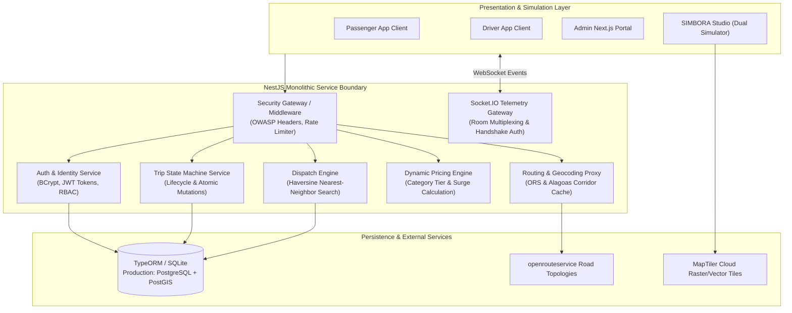
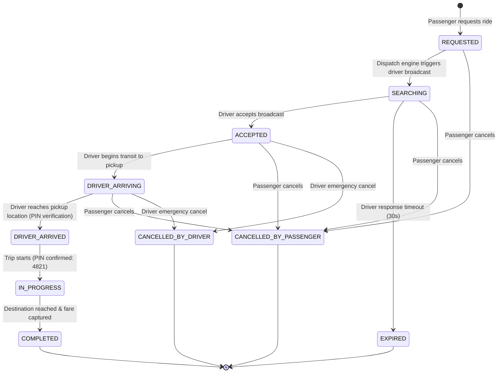

# SIMBORA Platform Architecture Specification

This document provides a detailed architectural specification of the **SIMBORA Mobility Platform**, describing domain boundaries, finite state machine semantics, dispatch algorithms, real-time telemetry protocols, and security boundaries.

---

## 1. Architectural Philosophy

SIMBORA is built around three foundational design tenets:
1. **Regional Topology First**: Ride-hailing in non-metropolitan Brazilian regions is dominated by intercity highway corridors (e.g., Alagoas state highways AL-101 and AL-225). Routing, ETA prediction, and pricing must reflect highway curvature and regional speeds rather than urban grid approximations.
2. **Deterministic State Lifecycle**: Every trip follows a formal Finite State Machine (FSM). State transitions are atomic, strictly validated, and guarded against race conditions.
3. **Defense-in-Depth Security**: Authentication and role-based access controls are enforced at both the HTTP edge and WebSocket transport layers, guaranteeing isolation between passengers, drivers, and administrators.

---

## 2. System Domain Decomposition

---

## 3. Trip Finite State Machine (FSM)

The trip lifecycle is governed by an explicit finite state machine. Invalid transitions are rejected with `HTTP 400 Bad Request` or domain exceptions.

### State Transition Matrix

| Current State | Target State | Permitted Roles | Preconditions / Validations |
| :--- | :--- | :--- | :--- |
| `REQUESTED` | `SEARCHING` | System / Passenger | Origin and destination coordinates validated. |
| `SEARCHING` | `ACCEPTED` | Driver | Driver must have status `ONLINE` and no active trip. |
| `SEARCHING` | `EXPIRED` | System | 30-second driver response timeout expired with no acceptance. |
| `ACCEPTED` | `DRIVER_ARRIVING` | Driver | Driver is en route to passenger pickup point. |
| `DRIVER_ARRIVING` | `DRIVER_ARRIVED` | Driver | Driver is within proximity threshold (< 100m) of pickup point. |
| `DRIVER_ARRIVED` | `IN_PROGRESS` | Driver | Valid 4-digit security PIN provided by passenger and verified. |
| `IN_PROGRESS` | `COMPLETED` | Driver | Trip reaches destination; final fare logged and charged. |
| `*` (Any active) | `CANCELLED_BY_PASSENGER` | Passenger | Only allowed prior to `IN_PROGRESS` without cancellation penalty. |
| `*` (Active prior to start) | `CANCELLED_BY_DRIVER` | Driver | Must provide valid cancellation reason; driver status resets to `ONLINE`. |

---

## 4. Dispatch & Matching Engine

The dispatch subsystem matches ride requests with nearby eligible drivers:

1. **Spatial Proximity Query**: Calculates great-circle distance between passenger pickup coordinates and all drivers with `status = 'ONLINE'` using the spherical **Haversine formula**:
   $$d = 2r \arcsin\left(\sqrt{\sin^2\left(\frac{\Delta \phi}{2}\right) + \cos(\phi_1)\cos(\phi_2)\sin^2\left(\frac{\Delta \lambda}{2}\right)}\right)$$
2. **Category & Vehicle Filtering**: Filters candidates by requested vehicle class (`economy`, `comfort`, `premium`) and verified vehicle documents.
3. **Sequential Driver Offer**: Sorts eligible candidates by distance. Dispatches a real-time event to the closest candidate with a 30-second acceptance lease to prevent race conditions and double-assignment.
4. **Fallback & Expiry**: If declined or timed out, the offer cascades to the next nearest candidate. If no candidate accepts within the search window, state shifts to `EXPIRED`.

---

## 5. Dynamic Pricing Engine

Fares are determined algorithmically based on road distance, estimated transit time, vehicle class base rates, and regional demand multipliers:

$$\text{Fare} = \max\left(\text{BaseFare} + (\text{Distance}_{\text{km}} \times \text{Rate}_{\text{km}}) + (\text{Duration}_{\text{min}} \times \text{Rate}_{\text{min}}), \text{MinimumFare}\right) \times \text{SurgeMultiplier}$$

### Pricing Matrix by Category

| Parameter | Economy | Comfort | Premium |
| :--- | :--- | :--- | :--- |
| **Base Fare** | R\$ 5.00 | R\$ 8.00 | R\$ 15.00 |
| **Per Kilometer Rate** | R\$ 1.60 | R\$ 2.30 | R\$ 3.50 |
| **Per Minute Rate** | R\$ 0.25 | R\$ 0.35 | R\$ 0.50 |
| **Minimum Fare** | R\$ 8.00 | R\$ 12.00 | R\$ 22.00 |

*Example (Piaçabuçu → Penedo, 28.2 km, 32 minutes):*
* **Economy**: R\$ 5.00 + (28.2 × 1.60) + (32 × 0.25) = **R\$ 54.30**
* **Comfort**: R\$ 8.00 + (28.2 × 2.30) + (32 × 0.35) = **R\$ 78.84**
* **Premium**: R\$ 15.00 + (28.2 × 3.50) + (32 × 0.50) = **R\$ 122.70**

---

## 6. Real-time Telemetry & WebSocket Protocol

Real-time bidirectional event synchronization is implemented on top of **Socket.IO**:

### Handshake & Authentication
Clients connecting to `ws://<host>:<port>` must supply a valid JWT token either through the `auth.token` handshake parameter or the `Authorization: Bearer <token>` header. Sockets failing signature verification or role checks are terminated immediately.

### Room Hierarchy
* `driver:{driverId}`: Direct notifications for driver dispatch offers, status shifts, and route updates.
* `passenger:{userId}`: Passenger-specific updates (driver acceptance, arrival, trip completion).
* `trip:{tripId}`: Shared telemetry room for vehicle coordinates, smooth bearing orientation, and ETA countdowns.
* `admin`: Dedicated operational monitoring feed accessible exclusively to users with `role: 'admin'`.

---

## 7. Security Boundaries & Threat Model

| Boundary | Threat | Mitigation Mechanism |
| :--- | :--- | :--- |
| **Client ↔ API Gateway** | Man-in-the-Middle (MitM), Injection | Strict OWASP response headers, TLS termination, input sanitization via NestJS ValidationPipe. |
| **Unauthenticated Edge** | Brute-force, Credential Stuffing | Sliding-window IP rate limiting (25 req/min on `/auth`, 300 req/min general). |
| **Registration Endpoint** | Privilege Escalation (CWE-269) | Hardcoded default `UserRole.PASSENGER`; client-supplied role payloads are strictly ignored. |
| **Admin Controller** | Unauthorized Mutation (CWE-306) | RBAC guards (`JwtAuthGuard`, `RolesGuard`) requiring authenticated administrator claims. |
| **WebSocket Ingestion** | Unauthorized Telemetry Snooping | Handshake token decoding and explicit role verification prior to joining sensitive rooms. |
