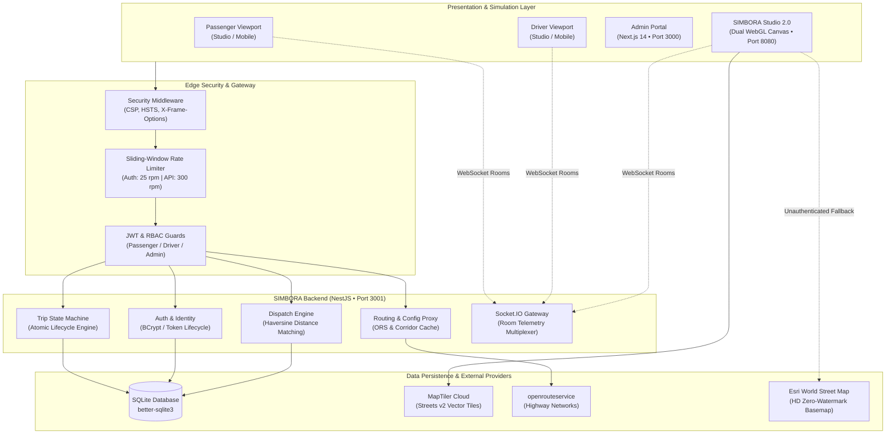

# SIMBORA — Urban and Intercity Mobility, Reimagined

[](SECURITY.md)
[](https://www.typescriptlang.org/)
[](https://nestjs.com/)
[](https://nextjs.org/)
[](https://maplibre.org/)
[](#14-license)

> **SIMBORA** is an independent, full-stack mobility platform engineered for regional transit, intercity highway travel, and real-time fleet synchronization, initially calibrated for the **State of Alagoas, Brazil**.

---

## 1. Project Header & Mission

Traditional ride-hailing platforms are designed predominantly for high-density metropolitan grids with short blocks and dense driver clusters. **SIMBORA** re-engineers the dispatch, routing, pricing, and telemetry architecture to address the operational and geographic realities of regional mobility: connecting decentralized municipalities, accommodating arterial highway corridors, and maintaining real-time situational awareness across long distances.

> [!NOTE]
> **Operational Status**: SIMBORA is an active engineering and research software platform developed for technical evaluation, simulation, and architectural verification. It is not currently operating as a commercial passenger transportation service.

---

## 2. Overview

### 2.1 Regional Mobility Context
The primary regional testbed is centered on **Alagoas, Brazil**, focusing on transit corridors between municipalities such as **Piaçabuçu**, **Penedo**, **Igreja Nova**, **Porto Real do Colégio**, **Coruripe**, **Arapiraca**, and **Maceió**. 

Key transit dynamics addressed:
* **Intercity Highway Corridors**: Highway topologies (e.g., AL-101 and AL-225) featuring single-lane sections, river crossings (Rio São Francisco), and distinct curvature profiles.
* **Deterministic Pricing Curves**: Distance and duration calculations that account for highway transit times rather than straight-line Euclidean metrics.
* **Dual-View Telemetry**: Real-time position, continuous bearing orientation, and ride lifecycle synchronization between passenger and driver viewports.

### 2.2 Independent Architecture
SIMBORA is built from the ground up as an independent technology platform. It utilizes open-source cartography (MapLibre GL JS), vector mapping services (MapTiler Cloud), highway topology analysis (openrouteservice / Turf.js), and a decoupled backend architecture (NestJS + Socket.IO + Next.js).

---

## 3. Key Features

| Domain | Feature | Status | Description |
| :--- | :--- | :---: | :--- |
| **Passenger Application** | Geocoding & Address Selection | **Implemented** | Origin and destination selection with coordinate snapping. |
| | Category Quoting & Fares | **Implemented** | Upfront pricing for Economy, Comfort, and Premium tiers. |
| | Live Ride Telemetry | **Implemented** | Real-time vehicle marker, continuous bearing, and ETA updates. |
| | Safety PIN Verification | **Implemented** | 4-digit pickup code (`4821` demo) to prevent misidentified boarding. |
| **Driver Application** | Duty Status Management | **Implemented** | Atomic state toggling between `ONLINE`, `BUSY`, and `OFFLINE`. |
| | Turn-by-Turn Telemetry | **Implemented** | Dynamic heading calculation (0°–360°) and corridor following. |
| | Lifecycle Actions | **Implemented** | Direct transitions (`ACCEPT`, `ARRIVED`, `START_TRIP`, `COMPLETE`). |
| **Admin Dashboard** | Real-Time Operations Telemetry | **Implemented** | Live operational metrics, active driver monitoring, and completed trips. |
| | Driver & Vehicle Approval | **Implemented** | Verification workflows for pending driver licenses and vehicle registrations. |
| | Audit & Event Logging | **Implemented** | Immutable logging of authentication, state shifts, and mutations. |
| **SIMBORA Studio** | Dual-Device Simulator | **Implemented** | Side-by-side logical 390×844 frames for passenger and driver views. |
| | Simulation Clock Controls | **Implemented** | Playback rates from 1x to 20x, interactive scrubbers, and step debugging. |
| | Zero Native Dependencies | **Implemented** | Pure WebGL and HTML5 Canvas running directly in modern web browsers. |
| **Geospatial & Routing** | Highway Corridor Routing | **Implemented** | 485 highway nodes along AL-101 / AL-225; Euclidean fallback disabled (422 error). |
| | Map Engine 2.0 | **Implemented** | MapLibre GL JS + MapTiler Streets v2 with zero-watermark HD fallback. |
| | Dynamic Geodesics | **Implemented** | Turf.js distance, along-path interpolation, and smooth azimuth rotation. |
| **Mobile Native** | Native Client Shells | **In Progress** | Standalone Expo / React Native wrappers utilizing shared packages. |
| **Persistence** | PostgreSQL + PostGIS | **Planned** | Drop-in migration from development SQLite to production PostGIS spatial indices. |

---

## 4. Technology Stack

The repository contains exclusively verified, active technologies:

```
├── Frontend & Web Simulators
│   ├── MapLibre GL JS 4.7.1      (Hardware-accelerated WebGL vector map rendering)
│   ├── Next.js 14.2.15           (React SSR administrative dashboard framework)
│   ├── React 18.3.1              (Component architecture & UI state management)
│   ├── Tailwind CSS 3.4.1        (Utility-first responsive design tokens)
│   ├── Recharts 2.12.7           (Administrative metrics and analytics visualization)
│   └── Lucide React              (Consistent iconography)
│
├── Backend & Real-Time APIs
│   ├── NestJS 10.4.5 / Node.js 24 (Modular TypeScript backend framework)
│   ├── Socket.IO 4.8.0           (Bi-directional room-multiplexed WebSocket gateway)
│   ├── Passport & JWT            (Stateless token authentication & RBAC guards)
│   ├── Class-Validator           (Strict payload schema validation pipes)
│   └── BCrypt 5.1.1              (High-cost salted password hashing)
│
├── Persistence & Database
│   ├── TypeORM 0.3.20            (Data-mapping ORM with repository patterns)
│   └── Better-SQLite3 11.4.0     (Embedded zero-dependency ACID SQL storage engine)
│
├── Geospatial & Routing
│   ├── Turf.js 6.5.0             (Spherical trigonometry, along-path interpolation, bearing)
│   ├── MapTiler Cloud            (Vector tile styles, glyphs, and sprite provider)
│   └── openrouteservice (ORS)    (Driving-car highway topology routing proxy)
│
└── Testing & CI/CD
    ├── GitHub Actions            (Automated secret scanning, compilation, unit tests)
    ├── Custom Hardening Suites   (OWASP headers, RBAC verification, routing integrity)
    └── Native Node Test Run      (Deterministic regression testing without third-party runners)
```

---

## 5. System Architecture



---

## 6. Getting Started

### Prerequisites
* **Node.js**: `v20.0.0` or higher (`v24.20.0` verified)
* **npm**: `v9.0.0` or higher
* **Git**: `2.30+`

### 1. Clone Repository & Install Dependencies
```bash
git clone https://github.com/jhonwictordev/mobility-platform.git
cd mobility-platform
npm install
```

### 2. Environment Configuration
Copy the provided sanitized environment templates:
```bash
# Root environment
cp .env.example .env.local

# Backend API environment
cp services/api/.env.example services/api/.env.local

# Admin Dashboard environment
cp apps/admin/.env.example apps/admin/.env.local
```

### 3. Build & Seed the Backend Database
```bash
cd services/api
npm run build
npm run seed
```
*Seeds synthetic demonstration passengers, certified drivers, and vehicles.*

### 4. Start Platform Services
You can run the platform components in separate terminal sessions:

```bash
# Terminal 1: Backend API & WebSocket (Port 3001)
cd services/api
npm run start

# Terminal 2: Admin Dashboard (Port 3000)
cd apps/admin
npm run dev

# Terminal 3: SIMBORA Studio (Port 8080)
node tests/serve_studio.js
```

Open your browser:
* **SIMBORA Studio**: [http://localhost:8080](http://localhost:8080)
* **Admin Dashboard**: [http://localhost:3000](http://localhost:3000)
* **Backend Health**: [http://localhost:3001/location/config](http://localhost:3001/location/config)

---

## 7. Environment Variables Reference

All secrets and credentials must be declared exclusively within local `.env.local` files, which are ignored by Git.

| Variable Name | Component | Scope | Purpose |
| :--- | :--- | :---: | :--- |
| `PORT` | API | Server | HTTP API listening port (`3001`). |
| `JWT_SECRET` | API | Server | 32+ character signing key for JSON Web Tokens. |
| `JWT_EXPIRES_IN` | API | Server | Token expiration duration (default `7d`). |
| `CORS_ORIGIN` | API | Server | Permitted HTTP origins for API requests. |
| `VITE_MAPTILER_KEY` | Studio / Root | Client | Public client key for MapTiler Cloud vector styles. |
| `NEXT_PUBLIC_MAPTILER_KEY`| Admin | Client | Public client key for Admin map previews. |
| `OPENROUTESERVICE_API_KEY`| API | Server | Backend server key for upstream routing queries. |

> [!WARNING]
> Never commit `.env`, `.env.local`, or private API tokens to source control. Refer to [.env.example](.env.example) for placeholder formats.

---

## 8. Geographic Simulation: Piaçabuçu → Penedo

The reference benchmark for SIMBORA's regional transit is the intercity highway corridor between **Piaçabuçu** and **Penedo** in the Lower São Francisco region of Alagoas:

```
[Piaçabuçu Center]  (-36.434405, -10.405602)
        │  AL-101 Northbound Highway
        ▼
[Pontal do Peba Junction] (-36.482928, -10.356613)
        │  AL-225 Inland Highway
        ▼
[Historic Penedo Center]  (-36.586452, -10.289673)
```

### Verified Routing Metrics
* **Euclidean Distance**: `21.06 km` (Straight line — rejected by system with HTTP 422).
* **Authentic Road Distance**: `28.20 km` (+33.9% road curvature factor).
* **Highway Node Count**: `485 nodes` extracted from verified road topology.
* **Continuous Bearing**: Turf.js computes tangential azimuth (0°–360°) at each road segment to rotate vehicle sprites smoothly without snapping or jitter.
* **Variable Simulation Speeds**: Supported multipliers include **1x, 2x, 5x, 10x, and 20x**, scaling the simulation clock while keeping vehicle dynamics realistic.

---

## 9. Security & Hardening

Security is an integral part of the SIMBORA platform architecture:

* **Automated Secret Scanning**: Scanned across current working tree and full commit history; zero hardcoded private keys or tokens.
* **Defense-in-Depth HTTP Headers**: Injected by `SecurityHeadersMiddleware`:
  * `X-Content-Type-Options: nosniff`
  * `X-Frame-Options: SAMEORIGIN`
  * `X-XSS-Protection: 1; mode=block`
  * `Strict-Transport-Security: max-age=31536000; includeSubDomains`
  * `Referrer-Policy: strict-origin-when-cross-origin`
* **Privilege Escalation Neutralization (CWE-269)**: User registration ignores client-supplied `role` attributes, strictly assigning `UserRole.PASSENGER`.
* **Administrative RBAC Enforcement (CWE-306 / CWE-862)**: Mutation endpoints (`/admin/drivers/:id/approve`, `/admin/vehicles/:id/approve`, `/trips`) require verified JWT tokens and `admin` role authorization.
* **WebSocket Handshake Authentication**: Tokens are validated during WebSocket connection negotiation; administrative monitoring channels are restricted.
* **Sliding-Window Rate Limiting**: Edge limiter restricting `/auth` endpoints to 25 req/min and general endpoints to 300 req/min.

For our complete vulnerability disclosure policy, read [SECURITY.md](SECURITY.md) and [SECURITY_AUDIT.md](SECURITY_AUDIT.md).

---

## 10. Privacy & Synthetic Demonstration Data

To ensure user privacy and maintain rigorous compliance standards:
* **Zero Real PII**: The repository contains **no real passenger, driver, or vehicle personally identifiable information**.
* **Synthetic Demonstrators**: All demonstration accounts utilize standard reserved RFC test domains (e.g., `user@example.com`), artificial Brazilian phone patterns, and synthetic vehicle plates (`BRA2E19`).
* **Location Minimization**: GPS coordinates broadcast during rides are ephemeral and consumed strictly for active trip interpolation. Off-duty drivers emit zero location telemetry.
* **LGPD Alignment**: Architected in accordance with Brazilian Data Protection Law (LGPD — Lei nº 13.709/2018) principles of purpose limitation, data minimization, and secure processing.

Detailed privacy specifications are documented in [PRIVACY.md](PRIVACY.md).

---

## 11. Development Status

| Module | Status | Verified Evidence |
| :--- | :---: | :--- |
| **Trip State Machine (FSM)** | Implemented | Strict lifecycle validation from `REQUESTED` to `COMPLETED`. |
| **SIMBORA Studio 2.0** | Implemented | Dual mobile views, speed multipliers, and interactive route scrubber. |
| **Map Engine 2.0** | Implemented | MapLibre GL JS, MapTiler Cloud Streets v2, Esri HD zero-watermark fallback. |
| **Highway Corridor Routing** | Implemented | 7 verified corridors in Alagoas, 485 nodes for Piaçabuçu ↔ Penedo. |
| **Dynamic Fare Engine** | Implemented | Tier pricing (Economy R\$ 54.30, Comfort R\$ 78.84, Premium R\$ 122.70). |
| **Admin Operations Portal** | Implemented | Next.js 14 dashboard with live metrics, driver review, and vehicle approvals. |
| **API Security Hardening** | Implemented | OWASP headers, JWT authentication, RBAC guards, and rate limiting. |
| **Mobile Native Packaging** | In Progress | React Native client foundations undergoing standalone workspace build. |
| **PostgreSQL / PostGIS** | Planned | Database abstraction prepared for drop-in spatial indexing migration. |
| **Pix Instant Payments** | Planned | Architecture models drafted for dynamic BACEN Pix QR codes and webhooks. |

---

## 12. Engineering Roadmap

- [ ] **Phase 1**: Migration from SQLite to PostgreSQL + PostGIS spatial indexing for high-concurrency production workloads.
- [ ] **Phase 2**: Redis adapter integration for Socket.IO horizontal scaling across multiple node processes.
- [ ] **Phase 3**: Dynamic Brazilian Instant Payment (Pix) QR code generation and automated webhook reconciliation.
- [ ] **Phase 4**: Standalone iOS and Android application distribution via Expo Application Services (EAS).
- [ ] **Phase 5**: Expansion of highway network pre-caching to cover all 102 municipalities in the State of Alagoas.

---

## 13. Contributing

We welcome technical contributions, security audits, and issue reports. Please review [CONTRIBUTING.md](CONTRIBUTING.md) for development guidelines, coding conventions, and pull request verification workflows.

---

## 14. License

This repository and its source code are currently marked **Proprietary / Under Review** pending formal open-source licensing determination by the repository owner. Demonstration fixtures, synthetic data, and documentation are provided for evaluation and portfolio review purposes.

---

## 15. Acknowledgments & Cartographic Attribution

* **[MapLibre GL JS](https://maplibre.org/)**: Open-source mapping engine licensed under the 3-Clause BSD License.
* **[MapTiler Cloud](https://www.maptiler.com/)**: Vector tiles, styling infrastructure, glyphs, and sprites.
* **[Turf.js](https://turfjs.org/)**: Advanced geospatial analysis for JavaScript.
* **[openrouteservice](https://openrouteservice.org/)**: Highway network topology and routing engine based on OpenStreetMap.
* **[OpenStreetMap Contributors](https://www.openstreetmap.org/)**: Open map data licensed under the Open Data Commons Open Database License (ODbL).
* **[Esri](https://www.esri.com/)**: World Street Map HD tiles used for zero-watermark cartographic fallback.
