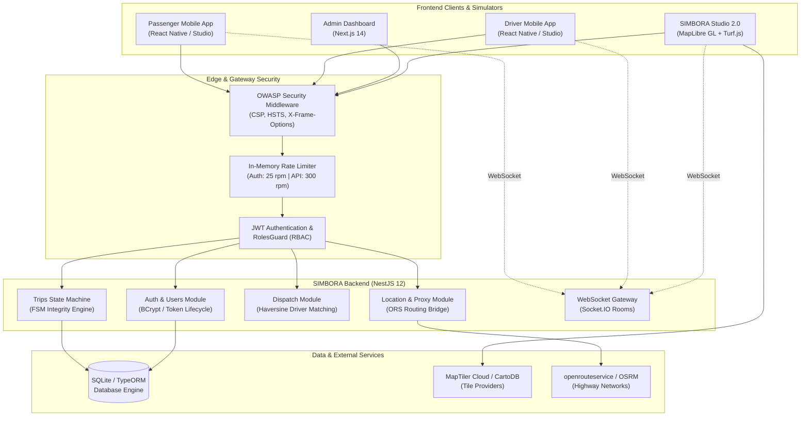

# SIMBORA — Urban and Intercity Mobility, Reimagined

[](#security)
[](https://www.typescriptlang.org/)
[](https://nestjs.com/)
[](https://nextjs.org/)
[](https://maplibre.org/)
[](#license)

---

## 1. Project Overview

**SIMBORA** is an open-architecture urban and intercity mobility platform designed specifically to meet the geographical, economic, and logistical realities of regional transit in Brazil, with an initial flagship deployment and simulation environment tailored to the **State of Alagoas**.

Unlike conventional ride-hailing applications built strictly for high-density metropolitan grids, SIMBORA accommodates long-distance intercity corridors connecting municipalities (e.g., Piaçabuçu, Penedo, Arapiraca, Coruripe, and Maceió), incorporating realistic road geometry, dynamic intercity pricing curves, dual-role WebSocket telemetry, and comprehensive administrative oversight.

The repository includes a decoupled monolithic NestJS backend, a Next.js administrative dashboard, cross-platform mobile app client foundations, and the **SIMBORA Studio** — an interactive dual-device web testbed that executes deterministic, real-time trip simulations over authentic highway networks.

---

## 2. Key Features

### 👤 Passenger Experience
* **Address Resolution & Geocoding**: Search and pick origins and destinations with real coordinate snapping.
* **Category Selection & Transparent Pricing**: Upfront quotes for Economy, Comfort, and Premium tiers calculated from authentic road distances and durations.
* **Driver Telemetry & Ride Tracking**: Live vehicle position, heading, and ETA updates pushed via WebSocket rooms.
* **Safety Verification**: 4-digit security PIN verification at pickup (`4821` in testbed) preventing ride misidentification.

### 🚗 Driver Application
* **Duty Status Management**: Instant state switching between `ONLINE`, `BUSY`, and `OFFLINE`.
* **Turn-by-Turn Corridor Telemetry**: Automatic heading calculation (0°–360° bearing) with path-following along verified highway corridors.
* **Trip Lifecycle Actions**: Formal transition controls (`ACCEPT`, `ARRIVED_AT_PICKUP`, `START_TRIP`, `COMPLETE`).

### 📊 Administrative Dashboard
* **Real-time Operations Telemetry**: Monitoring active trips, online drivers, and completed rides across regional clusters.
* **Lifecycle Oversight**: Manual verification, approval, or rejection of registered drivers and vehicles.
* **Security & Audit Logs**: Centralized immutable logging of authentication, state changes, and administrative actions.

### 🧪 SIMBORA Studio
* **Side-by-Side Dual Simulator**: Real-time interactive canvas hosting passenger and driver mobile viewports simultaneously.
* **Zero External Native Dependencies**: Operates directly in standard web browsers using MapLibre GL JS and HTML5 Canvas.
* **Highway Simulation Controls**: Variable simulation playback speeds (1x to 10x), step-by-step state advancement, and telemetry event logs.

---

## 3. Technology Stack

| Layer | Technologies | Justification & Role |
| :--- | :--- | :--- |
| **Backend API** | NestJS 12, Node.js 24, TypeScript | Modular architecture, strict dependency injection, built-in validation pipes. |
| **Persistence** | SQLite / TypeORM | Embedded ACID database for zero-dependency local development and CI execution. |
| **Real-time Engine**| Socket.IO / WebSockets | Bi-directional room-based event dispatching with JWT handshake authentication. |
| **Frontend Admin** | Next.js 14, React 18, Tailwind CSS | Server-side rendered administration portal with dynamic data tables and charts. |
| **Mobile Foundation**| React Native, Expo | Shared cross-platform client components and type contracts. |
| **Cartography** | MapLibre GL JS, MapTiler Cloud | Vector and raster tile rendering adhering to OSM/MapTiler acceptable use policies. |
| **Routing Engine** | openrouteservice (ORS) / OSRM Proxy | Driving-car highway network topology extraction (never straight-line Euclidean interpolation). |
| **Spatial Analysis**| Turf.js 6.5 | Spherical distance, along-path coordinate interpolation, and bearing calculations. |

---

## 4. Architecture



---

## 5. Getting Started

### Prerequisites
* **Node.js**: `v18.0.0` or higher (`v24.20.0` recommended)
* **npm**: `v9.0.0` or higher
* **Git**: `2.30+`

### Repository Setup
Clone the repository and inspect the directory structure:
```bash
git clone https://github.com/jhonwictordev/mobility-platform.git
cd mobility-platform
```

Install root and workspace dependencies:
```bash
npm install
```

---

## 6. Environment Configuration

All microservices and frontends utilize environment files modeled after sanitized templates. **Never commit `.env` or production credentials to the repository.**

Copy the template files before launching:
```bash
# Root environment
cp .env.example .env

# Backend API environment
cp services/api/.env.example services/api/.env

# Admin Dashboard environment
cp apps/admin/.env.example apps/admin/.env.local
```

### Key Configuration Variables

| Variable | Scope | Description | Default / Example |
| :--- | :--- | :--- | :--- |
| `PORT` | Backend | HTTP API listening port | `3001` |
| `JWT_SECRET` | Backend | Secret key used for signing session tokens | *Generate a 32+ byte string* |
| `JWT_EXPIRES_IN` | Backend | Token validity duration | `7d` |
| `CORS_ORIGIN` | Backend | Allowed CORS origins (comma-separated) | `http://localhost:3000,http://localhost:3001` |
| `OPENROUTESERVICE_API_KEY` | Backend | Upstream routing API key (optional fallback) | *Stored on server only* |
| `NEXT_PUBLIC_API_URL` | Admin | Backend REST endpoint URL | `http://localhost:3001` |
| `NEXT_PUBLIC_WS_URL` | Admin | Backend WebSocket endpoint URL | `http://localhost:3001` |

---

## 7. Local Development

SIMBORA can be run concurrently across all modules.

### 1. Launch Backend API (`http://localhost:3001`)
```bash
cd services/api
npm run build
npm run start
```
*The database automatically creates and seeds synthetic test fixtures on initial bootstrap.*

### 2. Launch Admin Portal (`http://localhost:3000`)
```bash
cd apps/admin
npm run dev
```

### 3. Launch SIMBORA Studio
Open `apps/studio/index.html` directly in any modern browser (or navigate via the local HTTP server).

---

## 8. Geographic Simulation: Piaçabuçu → Penedo

The centerpiece benchmark for SIMBORA's regional routing is the intercity corridor between **Piaçabuçu** and **Penedo** in the Lower São Francisco region of Alagoas.

```
Piaçabuçu Center [-36.434405, -10.405602]
         │  (AL-101 Northbound)
         ▼
Pontal do Peba Junction [-36.482928, -10.356613]
         │  (AL-225 Inland Highway)
         ▼
Historic Penedo [-36.586452, -10.289673]
```

### Road Characteristics & Validation
* **Euclidean Distance**: `21.06 km` (Straight line — invalid for vehicular transit).
* **Authentic Road Distance**: `28.20 km` (+33.9% highway curvature factor).
* **Node Density**: `485 high-precision highway nodes` following AL-101 and AL-225 asphalt alignments.
* **Continuous Azimuth (Bearing)**: Dynamically calculated via Turf.js to smoothly orient the vehicle sprite according to road curvature, eliminating erratic icon rotation.
* **Strict Road Geometry**: Attempting to query routes outside supported road networks returns `HTTP 422 Unprocessable Entity` rather than falling back to unrealistic straight lines.

---

## 9. Security Hardening

Security is integrated directly into the application core rather than bolted on as an afterthought.

* **No Hardcoded Secrets**: Scanned and verified using automated static analysis; zero plain-text tokens or credentials exist in source code or revision history.
* **OWASP Defense-in-Depth**: Strict security headers injected on every response (`X-Content-Type-Options: nosniff`, `X-Frame-Options: SAMEORIGIN`, `X-XSS-Protection`, `Strict-Transport-Security`, `Referrer-Policy`).
* **Privilege Escalation Protection (CWE-269)**: Registration endpoints strictly enforce passenger role assignment; role tampering payloads are discarded.
* **Role-Based Access Control (RBAC)**: Sensitive administrative mutation endpoints (`/admin/drivers/:id/approve`, `/admin/vehicles/:id/approve`, `/trips`) are shielded by combined `JwtAuthGuard` and `RolesGuard` filters.
* **Handshake JWT Verification**: WebSocket connection negotiation requires valid JWT tokens before admitting clients into private telemetry rooms.

For full disclosure details, remediation steps, and incident reporting policies, read [SECURITY.md](SECURITY.md) and [SECURITY_AUDIT.md](SECURITY_AUDIT.md).

---

## 10. Privacy & Synthetic Data

To safeguard user privacy and comply with global data protection principles:
* The repository contains **zero real customer, driver, or vehicle personally identifiable information (PII)**.
* All demonstration fixtures in `src/database/seed.ts` employ reserved test patterns (e.g., `user@example.com`, standard Brazilian synthetic format phone numbers, and placeholder vehicle registration plates).
* Production configurations mandate externalized database storage with encryption at rest.

Read our complete privacy statement in [PRIVACY.md](PRIVACY.md).

---

## 11. Development Status

| Component | Status | Implementation Details |
| :--- | :--- | :--- |
| **Core State Machine** | ✅ Stable / Implemented | Full trip lifecycle validation (`REQUESTED` → `COMPLETED`). |
| **SIMBORA Studio 2.0** | ✅ Stable / Implemented | MapLibre GL JS, Turf.js interpolation, dual mobile viewports. |
| **Highway Routing Proxy**| ✅ Stable / Implemented | Cached Alagoas road corridors with upstream fallback. |
| **Admin Dashboard** | ✅ Stable / Implemented | Next.js 14 metrics, driver & vehicle review tables. |
| **API Security Hardening**| ✅ Stable / Implemented | OWASP headers, JWT authentication, rate limiting middleware. |
| **Mobile Native Builds** | 🟡 In Progress | React Native client components undergoing standalone packaging. |
| **PostgreSQL / PostGIS** | 🔄 Architecture Ready | TypeORM entities designed for drop-in Postgres configuration. |
| **Payment Gateway** | 🔄 Architecture Ready | Webhook and settlement models drafted for Pix and card processors. |

---

## 12. Roadmap

- [ ] **Phase 1**: Migration from SQLite to PostgreSQL + PostGIS spatial indexing for high-concurrency production workloads.
- [ ] **Phase 2**: Redis adapter integration for Socket.IO horizontal scaling across multiple node processes.
- [ ] **Phase 3**: Native Brazilian Instant Payment (Pix) dynamic QR code generation and automated webhook reconciliation.
- [ ] **Phase 4**: Standalone iOS and Android application distribution via Expo Application Services (EAS).
- [ ] **Phase 5**: Expansion of highway network pre-caching to cover all 102 municipalities in the State of Alagoas.

---

## 13. Contributing

We welcome technical contributions, security audits, and issue reports. Please review [CONTRIBUTING.md](CONTRIBUTING.md) for development guidelines, coding conventions, and pull request verification workflows.

---

## 14. License

This repository and its original source code are currently marked **Proprietary / Under Review** pending formal open-source licensing determination by the repository owner. Demonstration fixtures, synthetic data, and documentation are provided for evaluation and portfolio review purposes.

---

## 15. Acknowledgments

* [MapLibre GL JS](https://maplibre.org/) — Community-driven open-source mapping engine.
* [Turf.js](https://turfjs.org/) — Advanced spatial analysis in JavaScript.
* [NestJS](https://nestjs.com/) — Progressive Node.js framework.
* [Next.js](https://nextjs.org/) — The React Framework for the Web.
* [OpenStreetMap](https://www.openstreetmap.org/) contributors — Geodata foundation.
