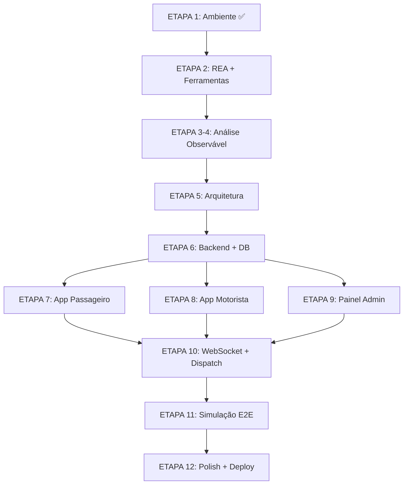

# 🚀 Mobility Platform — Plano Inicial de Execução

## Inspeção do Ambiente

| Recurso | Status | Versão/Detalhe |
|---------|--------|----------------|
| Node.js | ✅ Disponível | v24.20.0 |
| npm | ✅ Disponível | 11.19.0 |
| npx | ✅ Disponível | — |
| Python | ✅ Disponível | 3.12 |
| Git | 🟡 Instalando | MinGit portable (sem admin) |
| Docker | ❌ Indisponível | Requer privilégio admin |
| PostgreSQL | ❌ Indisponível | Sem Docker, sem admin |
| Redis | ❌ Indisponível | Sem Docker, sem admin |
| RAM | ⚠️ 3.7 GB | Limitado para desenvolvimento |
| Disco | ⚠️ 7.1 GB | Limitado para node_modules múltiplos |

## REA (Reverse Engineer Anything)

O REA é um **MCP server** disponível via `npx rea-agents`. Funcionalidades:
- Integra AI agents com ferramentas de engenharia reversa
- Suporta análise de binários nativos, apps JavaScript/Electron
- Requer disassemblers (Ghidra, IDA Pro, Hopper) para análise de binários nativos
- **Sem APK fornecido**: a análise de engenharia reversa do Uber não será executada

> [!IMPORTANT]
> Nenhum APK foi fornecido pelo usuário. A Fase 2 será realizada exclusivamente com base em **comportamento publicamente observável** e documentação pública da Uber.

## Decisões Arquiteturais — Adaptações Necessárias

Dado o ambiente limitado, proponho as seguintes adaptações:

### Banco de Dados
- **Original**: PostgreSQL + PostGIS (Docker)
- **Adaptação**: **SQLite com extensão de cálculo geográfico** (Haversine formula) para desenvolvimento local
- Os schemas SQL são projetados para PostgreSQL e a migração é direta

### Cache e Filas
- **Original**: Redis
- **Adaptação**: **Implementação in-memory** com Map/Set do Node.js para dev
- Interface compatível para futura migração para Redis

### Infraestrutura
- **Original**: Docker Compose
- **Adaptação**: Scripts npm para iniciar serviços localmente
- Dockerfile/compose mantidos como documentação

### Monorepo
- **Abordagem**: npm workspaces para gerenciar os pacotes
- Economiza espaço em disco com hoisting de dependências

## Ordem de Execução

## Riscos e Mitigações

| Risco | Impacto | Mitigação |
|-------|---------|-----------|
| Sem Docker/PostgreSQL | Alto | SQLite + schemas PostgreSQL compatíveis |
| RAM limitada (3.7 GB) | Médio | Executar um serviço por vez, builds incrementais |
| Disco limitado (7.1 GB) | Médio | npm workspaces, dependências compartilhadas |
| Sem APK para análise | Baixo | Documentação baseada em comportamento observável |
| Sem Redis | Médio | Cache in-memory com interface compatível |
