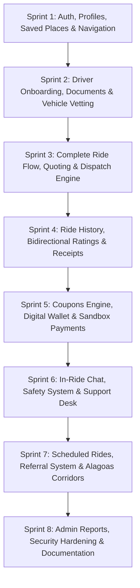

# SIMBORA 3.0 — Comprehensive Platform Implementation Plan
**Alagoas Urban & Intercity Mobility Engineering Roadmap**

---

## 1. Executive Summary & Architecture Overview

SIMBORA is a Brazilian mobility platform engineered specifically for urban and intercity transportation in the State of Alagoas, with initial core operations in **Penedo**, **Piaçabuçu**, and the Lower São Francisco basin (AL-101 / AL-225 corridor).

The system consists of 4 main subsystems:
1. **NestJS API & Real-Time Engine (`services/api`)**: High-performance backend running on Node.js / TypeORM with SQLite (`better-sqlite3`), Haversine geospatial calculations, and Socket.IO real-time rooms.
2. **Next.js 14 Admin Panel (`apps/admin`)**: Operations center for ride tracking, driver vetting, vehicle management, and financial surge/rate configuration.
3. **Passenger Mobile App (`apps/passenger`)**: React Native / Expo application with interactive quote, driver matching, route visualization, and saved locations.
4. **Driver Cockpit Mobile App (`apps/driver`)**: React Native / Expo cockpit with telemetry broadcasting, turn-by-turn guidance, security PIN entry, and earnings tracking.
5. **SIMBORA Studio 2.0 (`mobility_interactive_studio.html`)**: Multi-device cartographic simulator powered by MapLibre GL JS, Turf.js, and authenticated MapTiler Cloud Streets v2.

---

## 2. Existing vs. Incomplete vs. Missing Matrix

| Domain | Status | Existing Capabilities | Incomplete / Needs Hardening | Missing (To Build in Sprints) |
| :--- | :---: | :--- | :--- | :--- |
| **Authentication & Identity** | 🟡 Incomplete | JWT login/register for passengers and admin; BCrypt hashing; basic RBAC. | Driver registration flow; token refresh; session persistence. | OTP SMS/Phone verification; Forgot/Reset password flows; Terms & Privacy acceptance; Account self-deletion. |
| **User & Profile Management** | 🟡 Incomplete | `GET /users/me`, IDOR-protected user query, sanitization of password hash. | Profile updates (name, avatar, phone). | Saved addresses (Casa, Trabalho, Favoritos); Travel preferences; Password change; Emergency contacts. |
| **Driver & Vehicle Vetting** | 🟡 Incomplete | Driver entity, vehicle entity, admin approve/reject buttons. | Document upload & storage; vehicle category classification. | Multi-stage onboarding, CNH validation, vehicle background verification, public driver profile card. |
| **Trip Lifecycle & Dispatch** | 🟢 Operational | 10-state machine; Haversine geospatial driver lookup; 485-node road geometry; security PIN. | Concurrency handling on simultaneous driver acceptance. | Dynamic surge pricing engine; multi-driver fallback queues; ride scheduling. |
| **Financial & Payments** | 🟡 Incomplete | Payment entity, mock credit card / PIX status update. | Idempotency key tracking; refund processing. | Double-entry transactional wallet ledger; promotional credits; driver payout requests; split payments. |
| **Promotions & Coupons** | 🔴 Missing | None. | None. | Coupon engine (percentage, fixed, first ride, city-specific); redemption limits; validation in fare quotes. |
| **Ride History & Invoicing** | 🟡 Incomplete | Basic completed trips query in SQLite. | Detailed breakdown (driver cut, platform fee, time/km components). | PDF/receipt generation; itemized cancellation fees; route playback. |
| **Ratings & Feedback** | 🟡 Incomplete | Basic rating (1-5) and review string on Trip entity. | None. | Bidirectional ratings (passenger ↔ driver); feedback tags (limpeza, pontualidade); moderation. |
| **Safety & Incident Response** | 🟡 Incomplete | 4-digit security PIN validation on board. | None. | Trusted contacts; Live trip sharing link; SOS emergency trigger; incident reporting. |
| **Communications & Chat** | 🔴 Missing | None. | None. | In-ride encrypted chat via WebSockets; canned quick messages; automated communication tear-down after drop-off. |
| **Support & Help Desk** | 🔴 Missing | None. | None. | Support tickets; ticket categories (lost item, billing dispute, driver conduct); admin resolution workflow. |
| **Intercity Mobility** | 🟢 Operational | 7 Alagoas corridors defined; 28.2 km Piaçabuçu ↔ Penedo verified. | Dynamic regional base fares. | Intercity scheduled departure boards; multi-city corridors (Arapiraca, Maceió, Coruripe). |
| **Cartography & Maps** | 🟢 Operational | MapLibre GL JS + MapTiler Streets v2 + Turf.js; Zero OSM 403. | None. | None (Fully hardened in Engine 2.0). |

---

## 3. Sprint Execution Roadmap

### Detailed Sprint Breakdown:

- **Sprint 1 (Current Focus)**:
  - Database: Add OTP fields, password reset tokens, preferences, and `SavedPlace` entity.
  - Backend: `/auth/register` (Passenger/Driver role separation), `/auth/send-otp`, `/auth/verify-otp`, `/auth/forgot-password`, `/auth/reset-password`, `/auth/terms`, `/auth/privacy`.
  - User Module: `PATCH /users/me`, `PUT /users/me/password`, `DELETE /users/me`, `GET/POST/DELETE /users/me/places`.
  - Frontend: Passenger "Minha Conta" with full address management, driver auth & account screen, updated navigation.
  - Verification: 100% automated test suite (`tests/test_sprint1_auth_and_profiles.js`).

- **Sprint 2**: Driver onboarding, documents submission (CNH, CRLV), vehicle registration, admin vetting workflow.
- **Sprint 3**: Ride state machine hardening, concurrency locking, quote generation, real-time WebSocket room events.
- **Sprint 4**: Trip history with pagination, bidirectional ratings, itemized receipts, cancellation reasons & fee calculation.
- **Sprint 5**: Promotional coupons, transactional wallet ledger, PIX & card sandbox payments, driver withdrawal requests.
- **Sprint 6**: Ride-linked WebSocket chat, trusted contacts, emergency SOS button, help desk support tickets.
- **Sprint 7**: Scheduled trips, referral promo codes, 7 intercity Alagoas corridors configuration.
- **Sprint 8**: Enterprise admin analytics, export logs, full security audit, final documentation in English.

---

## 4. Architectural Constraints & Compliance

1. **Security & Data Privacy (LGPD)**: Passwords hashed with BCrypt (10 rounds); PII and tokens sanitized from logs; password hashes excluded from all JSON serializations.
2. **Zero Fakes**: Every UI component, button, and navigation action binds directly to verified HTTP/WebSocket endpoints backed by SQLite TypeORM.
3. **Database Integrity**: Foreign key constraints, cascade rules, and entity relations properly typed and enforced.
