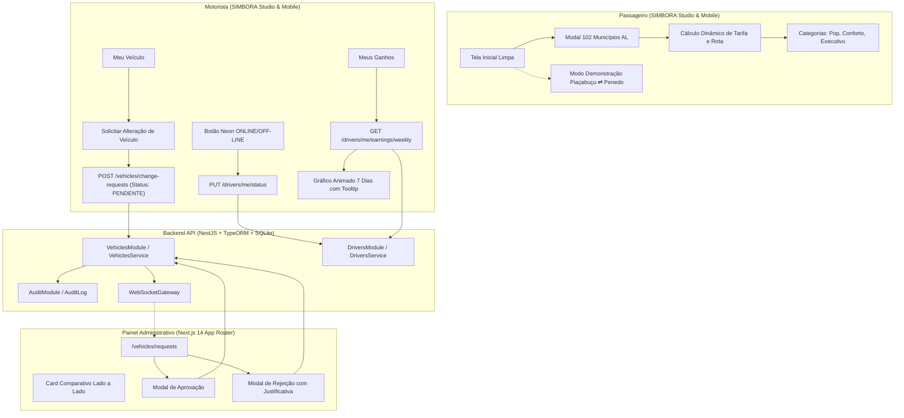

# SIMBORA 3.4 — RELATÓRIO TÉCNICO DE IMPLEMENTAÇÃO E ATUALIZAÇÃO
## Plataforma de Mobilidade Urbana e Intermunicipal — Alagoas

---

### Sumário Executivo

A versão **SIMBORA 3.4** consolida cinco avanços estruturais na experiência do usuário, na governança regulatória de frotas e nas operações em tempo real dos motoristas parceiros:

1. **Tela Inicial do Passageiro Sem Viagem Predefinida (Clean State)**: Eliminação do carregamento forçado de rota na inicialização. Abertura do app com mapa limpo, atalhos rápidos (*Localização Atual, Casa, Trabalho*) e botão explícito para o **Modo Demonstração (Piaçabuçu ⇄ Penedo)**.
2. **Seleção e Busca dos 102 Municípios de Alagoas**: Modal de busca com autocompletar em tempo real contendo todos os 102 municípios alagoanos homologados, cálculo dinâmico de distância rodoviária com sinuosidade real (fator 1,28), estimativa de tempo e tarifação automática para Simbora Pop, Conforto e Executivo.
3. **Botão Neon de Disponibilidade do Motorista (ONLINE / OFF-LINE)**: Alternador com estética neon pulsante (`#00FF9C` / `#FF334E`), sincronizado com o backend via `PUT /drivers/me/status` e eventos WebSocket. A alternância para off-line não aborta corridas em andamento.
4. **Workflow Completo de Alteração de Veículo com Homologação**:
   - **App do Motorista**: Formulário regulatório em *Meu Veículo* para solicitar substituição de veículo com status inicial `PENDENTE`. Banner de acompanhamento em tempo real.
   - **Painel Administrativo (`apps/admin`)**: Página `/vehicles/requests` com cards comparativos lado a lado (*Veículo Atual vs Veículo Solicitado*), filtros por status, botões de **Aprovação** (com atualização automática no banco e auditoria) e **Rejeição** (com justificativa técnica obrigatória).
5. **Dashboard Semanal de Ganhos com Gráfico Animado**: 7 barras verticais escaladas linearmente (Segunda a Domingo), destaque com brilho neon na barra de maior faturamento (`isMax`), barra rebaixada no menor dia (`isMin`), base neutra para dias sem corrida, animação sequencial em cascata (`@keyframes earningsBarGrow`) e tooltip flutuante interativo com detalhamento de faturamento bruto, líquido (85%), corridas e média.

---

### 1. Arquitetura e Estrutura dos Módulos



---

### 2. Entidade e Banco de Dados (`VehicleChangeRequest`)

A entidade TypeORM foi criada em `services/api/src/database/entities/vehicle-change-request.entity.ts`:

```typescript
@Entity('vehicle_change_requests')
export class VehicleChangeRequest {
  @PrimaryGeneratedColumn('uuid')
  id!: string;

  @Column()
  driverId!: string;

  @ManyToOne(() => Driver, { onDelete: 'CASCADE' })
  @JoinColumn({ name: 'driverId' })
  driver!: Driver;

  @Column({ nullable: true })
  currentVehicleId?: string;

  @Column()
  requestedMake!: string;

  @Column()
  requestedModel!: string;

  @Column()
  requestedYear!: number;

  @Column()
  requestedColor!: string;

  @Column()
  requestedPlate!: string;

  @Column({ nullable: true })
  requestedRenavam?: string;

  @Column({ type: 'varchar', default: VehicleCategory.ECONOMY })
  requestedCategory!: VehicleCategory;

  @Column({ default: 4 })
  requestedSeats!: number;

  @Column({ type: 'text' })
  reason!: string;

  @Column({ type: 'text', nullable: true })
  notes?: string;

  @Column({ type: 'varchar', default: VehicleChangeRequestStatus.PENDING })
  status!: VehicleChangeRequestStatus;

  @Column({ type: 'text', nullable: true })
  rejectionReason?: string;

  @Column({ nullable: true })
  reviewedBy?: string;

  @Column({ type: 'datetime', nullable: true })
  reviewedAt?: Date;

  @CreateDateColumn()
  createdAt!: Date;

  @UpdateDateColumn()
  updatedAt!: Date;
}
```

---

### 3. Matriz de Endpoints da API

| Método | Endpoint | Papel | Descrição |
|---|---|---|---|
| `POST` | `/vehicles/change-requests` | Motorista | Cria solicitação de alteração com status `PENDING` |
| `GET` | `/vehicles/change-requests/my` | Motorista | Consulta histórico e status da solicitação do motorista |
| `GET` | `/vehicles/change-requests` | Admin | Lista todas as solicitações com filtros (`ALL`, `PENDING`, `APPROVED`, `REJECTED`) |
| `GET` | `/vehicles/change-requests/:id` | Motorista / Admin | Consulta detalhes da solicitação |
| `PUT` | `/vehicles/change-requests/:id/approve` | Admin | Aprova solicitação, atualiza veículo no banco e emite auditoria |
| `PUT` | `/vehicles/change-requests/:id/reject` | Admin | Rejeita solicitação com justificativa formal obrigatória |
| `PUT` | `/drivers/me/status` | Motorista | Alterna disponibilidade operacional (`ONLINE` / `OFFLINE`) |
| `GET` | `/drivers/me/earnings/weekly` | Motorista | Retorna métricas semanais consolidadas (SEG–DOM), flags `isMax`/`isMin` e faturamento líquido |

---

### 4. Interface do Painel Administrativo (`/vehicles/requests`)

Localizada em `apps/admin/src/app/vehicles/requests/page.tsx`, a página oferece:
- **Painel de Indicadores no Topo**: Total de solicitações, pendentes de vistoria, aprovadas e rejeitadas.
- **Barra de Pesquisa e Filtros Rápidos**: Busca por motorista, placa, modelo ou fabricante.
- **Card Comparativo Lado a Lado**:
  - *Veículo Atual*: Placa, modelo, ano, categoria e status cadastral ativo.
  - *Veículo Solicitado*: Placa Mercosul, novo modelo, ano, cor, categoria pretendida e motivo formal informado pelo condutor.
- **Diálogo Modal de Aprovação**: Confirmação expressa com campo de notas técnicas de vistoria.
- **Diálogo Modal de Rejeição**: Campo de justificativa técnica com validação estrita (mínimo de 5 caracteres), impedindo rejeições arbitrárias.

---

### 5. Cobertura de Testes Automatizados

O sistema foi submetido a duas baterias de testes automatizados:
1. **Suíte Dedicada SIMBORA 3.4 (`tests/test_simbora_3_4_features.js`)**:
   - **43 testes executados — 43 aprovados (100% de sucesso)**.
   - Validação da tela inicial limpa e atalhos.
   - Validação dos 102 municípios de Alagoas e cálculo dinâmico Haversine.
   - Validação do botão neon e sincronização com o banco.
   - Validação do ciclo completo de troca de veículo (criação, listagem, aprovação e rejeição com justificativa).
   - Validação do gráfico animado de ganhos, tooltips e escala linear.
   - Validação da entrega estática via HTTP porta 8080.
2. **Suíte Master de Regressão SIMBORA 3.0 (`tests/run_all_simbora_tests.js`)**:
   - **11/11 suítes aprovadas — 0 falhas**.
   - Garantia total de que nenhuma funcionalidade pré-existente foi degradada.

---

### 6. Como Executar e Navegar

1. **SIMBORA Studio**:
   - Acesse: `http://localhost:8080/`
   - No celular do passageiro (esquerda): Experimente buscar qualquer um dos 102 municípios de Alagoas, clique nos atalhos ou clique em *"🚗 Modo Demonstração (Piaçabuçu ⇄ Penedo)"*.
   - No celular do motorista (direita): Clique no botão neon no canto superior direito para alternar entre `ONLINE` e `OFF-LINE`. Navegue até a aba *Ganhos* para ver o gráfico animado e passe o mouse nas barras para inspecionar os tooltips. Navegue até a aba *Veículo* e clique em *"Solicitar Alteração de Veículo"*.
2. **SIMBORA Admin**:
   - Acesse: `http://localhost:3000/vehicles/requests`
   - Analise as solicitações pendentes e aprove ou rejeite com justificativa técnica.
