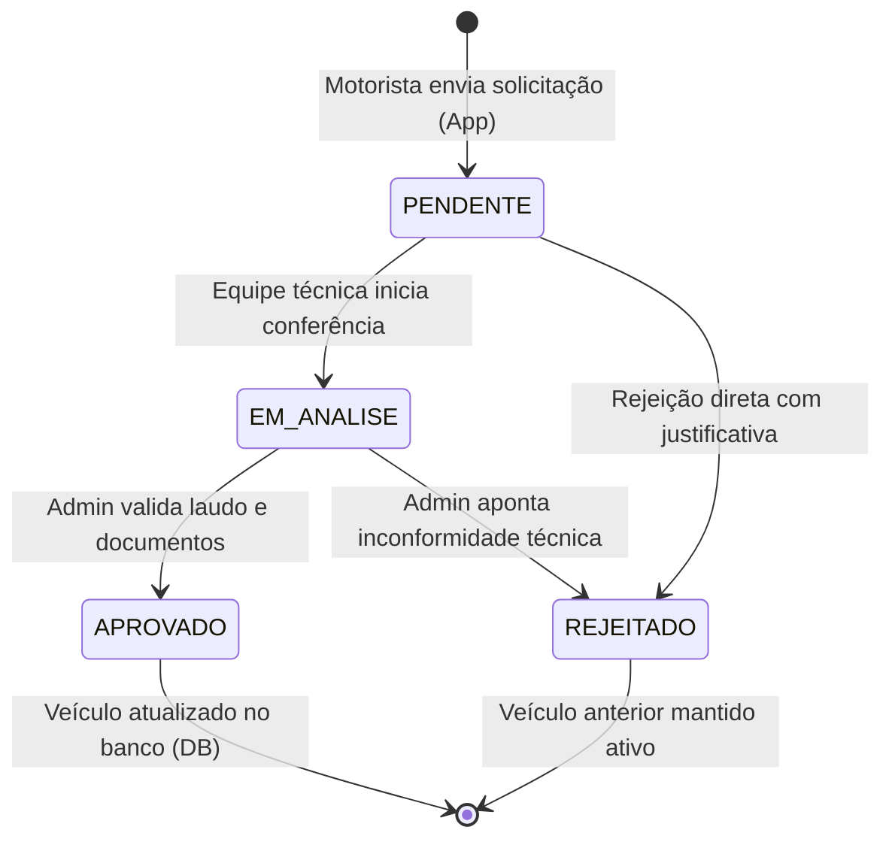

# SIMBORA 3.4 — WORKFLOW DE ALTERAÇÃO E HOMOLOGAÇÃO DE VEÍCULOS
## Regulamentação de Frotas, Gestão Administrativa e Ciclo de Vida do Veículo

---

### 1. Contexto Regulatório e Diretrizes

No transporte de passageiros em Alagoas, a segurança dos usuários e a conformidade com as normas municipais e estaduais exigem que **nenhum motorista parceiro possa substituir seu veículo operacional de forma unilateral ou instantânea**. 

A substituição requer verificação de conformidade:
- Ano de fabricação compatível com a categoria regulamentar (mínimo de 2014 para Pop/Conforto).
- Placa no padrão Mercosul devidamente registrada no Detran.
- Certificado de Registro e Licenciamento de Veículo (CRLV digital) atualizado.
- Laudo de vistoria técnica presencial ou documental aprovado.

---

### 2. Máquina de Estados da Solicitação



- **Princípio da Continuidade Operacional**: Durante todo o período em que a solicitação estiver com status `PENDENTE` ou `EM_ANALISE`, o veículo anterior do motorista **permanece 100% ativo e habilitado para receber corridas**. Não há interrupção no ganho do condutor.

---

### 3. Fluxo no Aplicativo do Motorista (SIMBORA Motorista)

1. **Acesso**: O condutor abre a aba *Veículo* e clica no botão *"Solicitar Alteração de Veículo"*.
2. **Formulário Regulatório**:
   - Fabricante / Marca (ex: `Toyota`).
   - Modelo detalhado (ex: `Corolla Cross XRE 2.0`).
   - Ano de Fabricação (validador numérico de 2014 a 2026).
   - Placa Mercosul (formato `ABC1D23` ou `SIM-3400`).
   - Cor oficial do veículo.
   - Categoria pretendida (*Simbora Pop, Conforto ou Executivo*).
   - Motivo formal da alteração (campo obrigatório).
   - Observações técnicas e referência a laudos (opcional).
3. **Submissão e Banner de Acompanhamento**:
   - Uma chamada `POST /vehicles/change-requests` é realizada.
   - O condutor recebe o número de protocolo do chamado.
   - Um banner de rastreamento com status `HOMOLOGAÇÃO EM ANÁLISE (PENDENTE)` é exibido no topo da tela do veículo, permitindo ao motorista consultar a evolução do processo em tempo real.

---

### 4. Fluxo no Painel Administrativo (`apps/admin/src/app/vehicles/requests`)

A equipe de operações e fiscalização do SIMBORA gerencia a fila na rota dedicada `/vehicles/requests`:

1. **Indicadores em Tempo Real**: Total de solicitações, pendentes, aprovadas e rejeitadas.
2. **Cards Comparativos Lado a Lado**:
   - **Lado Esquerdo (Veículo Atual Ativo)**: Fabricante, modelo, ano, placa atual, categoria e status cadastral.
   - **Lado Direito (Veículo Solicitado)**: Novos dados técnicos submetidos, categoria pretendida e justificativa declarada pelo motorista.
3. **Aprovação Técnica**:
   - O administrador clica em *"APROVAR ALTERAÇÃO"*.
   - Um modal de confirmação solicita notas de vistoria (ex: *"CRLV 2026 e vistoria presencial conferidos"*).
   - Ao confirmar, o endpoint `PUT /vehicles/change-requests/:id/approve` é disparado:
     - O registro do veículo na tabela `vehicles` é atualizado atomicamente.
     - O status da solicitação passa para `APPROVED`.
     - Um evento WebSocket `driver:vehicle_change_approved` é transmitido ao condutor.
     - O evento é registrado na trilha de auditoria imutável (`AuditLog`).
4. **Rejeição com Justificativa Obrigatória**:
   - O administrador clica em *"REJEITAR ALTERAÇÃO"*.
   - O sistema exige obrigatoriamente uma justificativa técnica formal (mínimo de 5 caracteres), como: *"Ano de fabricação do veículo anterior a 2014 — incompatível com o regulamento municipal"*.
   - Ao confirmar, o endpoint `PUT /vehicles/change-requests/:id/reject` é disparado:
     - O status passa para `REJECTED`.
     - O veículo atual do condutor continua operando sem modificações.
     - A justificativa é transmitida ao condutor e registrada na auditoria.

---

### 5. Auditoria e Rastreabilidade (`AuditLog`)

Todas as ações de criação, aprovação e rejeição gravam logs detalhados:

```json
{
  "entityType": "VehicleChangeRequest",
  "entityId": "e1f2a3b4-...",
  "action": "APPROVE_VEHICLE_CHANGE_REQUEST",
  "userId": "admin-uuid",
  "details": {
    "driverId": "driver-uuid",
    "updatedPlate": "SIM3400",
    "notes": "Vistoria presencial conferida e aprovada"
  },
  "createdAt": "2026-10-24T14:13:46.000Z"
}
```

Essa trilha garante conformidade com exigências fiscais e órgãos reguladores de trânsito em Alagoas.
