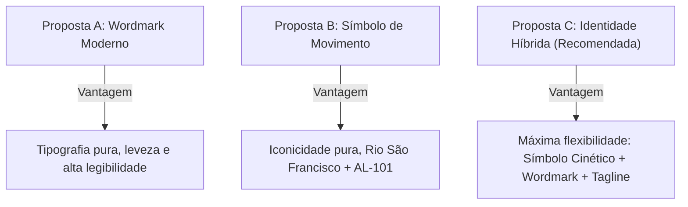

# 🌿 BRAND GUIDELINES — SIMBORA
## Identidade Oficial da Plataforma Brasileira de Mobilidade Urbana e Intermunicipal

> **"Pediu. Chegou. Simbora!"**  
> *A mobilidade ágil, segura e próxima, com o calor e a energia do Brasil.*

---

## 1. Concepção e Posicionamento da Marca

### 1.1 Missão
Conectar pessoas, cidades e oportunidades com transporte seguro, confiável e acessível, valorizando as particularidades locais de cada região do Brasil a partir do berço alagoano.

### 1.2 Visão
Ser a plataforma de mobilidade regional e intermunicipal mais admirada do Nordeste e do Brasil, reconhecida pela excelência tecnológica com calor humano, justa remuneração para motoristas parceiros e previsibilidade para passageiros.

### 1.3 Valores Fundamentais
1. **Confiança e Segurança:** Cada viagem é monitorada em tempo real com validação obrigatória por PIN e telemetria GPS constante.
2. **Proximidade e Calor Humano:** Atendimento e linguagem acessíveis, acolhedores e empáticos.
3. **Agilidade e Simplicidade:** Da solicitação ao desembarque, o fluxo é direto, sem telas desnecessárias ou termos corporativos herméticos.
4. **Identidade Brasileira e Orgulho Regional:** Celebramos os caminhos do Brasil, com início no encontro histórico das águas do Rio São Francisco em Alagoas.
5. **Transparência Tarifária:** Sem pegadinhas ou tarifas abusivas no fim da corrida.

---

## 2. Personalidade da Marca (Brand Persona)

A SIMBORA é personificada como aquele amigo pontual, solícito e experiente, que conhece cada curva da estrada e cada atalho da cidade. Ela combina a **precisão de uma startup de tecnologia global** com a **simpatia e hospitalidade alagoana**.

- **Voz:** Positiva, direta, prestativa, respeitosa e enérgica.
- **Tom de Comunicação:**
  - *No App do Passageiro:* Confortável, encorajador, pontual.
  - *No App do Motorista:* Claro, focado em autonomia, respeito à direção e clareza nos ganhos.
  - *No Painel Operacional/Admin:* Analítico, rigoroso, executivo e métrico.

---

## 3. Slogans da Marca

### 3.1 Slogan Oficial (Assinatura Primária)
> **"Pediu. Chegou. Simbora!"**

*Racional:* Sintético, com métrica rítmica de 3 tempos ("tricolon"), extremamente memorável na oralidade popular brasileira. Comunica imediatismo ("pediu"), confiabilidade na chegada ("chegou") e a ação festiva/resoluta de partir ("simbora!").

### 3.2 Alternativas Estratégicas Avaliadas
1. **"Seu caminho sem complicação."**  
   *Foco:* Fricção zero e usabilidade simples para todas as idades.
2. **"Mobilidade com o calor da nossa terra."**  
   *Foco:* Apelo regional emotivo e identificação cultural nordestina.
3. **"De ponta a ponta, vai de Simbora."**  
   *Foco:* Corredores intermunicipais de longa distância (ex: Piaçabuçu a Penedo).
4. **"A rota certa pro seu dia render."**  
   *Foco:* Trabalhadores, estudantes e rotina produtiva diária.
5. **"Conectando cidades, aproximando pessoas."**  
   *Foco:* Institucional e integração comunitária.

---

## 4. Comparativo Fundamentado das 3 Propostas Visuais

### Proposta A — Wordmark Moderno Alagoano
- **Conceito:** O nome SIMBORA desenhado com geometria arredondada exclusiva, terminação amigável e um corte cinético a 7° no travessão da letra 'A'.
- **Pontos Fortes:** Leitura imediata em outdoors, ônibus e faixas de rua.
- **Limitação:** Em tamanhos diminutos (ícone de relógio inteligente ou favicon 16px), a palavra perde impacto sem um pictograma de suporte.

### Proposta B — Símbolo de Movimento (Curva do Rio & Seta de Partida)
- **Conceito:** Um glifo dinâmico em fita contínua em formato de 'S', conectando o ponto de origem (verde vibrante `#16A572`, simbolizando Piaçabuçu e o mar) à seta de chegada dourada (`#FFCC45`, simbolizando o destino Penedo e o sol).
- **Pontos Fortes:** Altíssima memorização visual, distinção imediata frente a ícones genéricos de carros, versatilidade em ícones de sistema e animações.
- **Limitação:** Quando usado isoladamente sem o nome, exige tempo de maturação de reconhecimento de marca pelo grande público.

### Proposta C — Identidade Híbrida Integrada (**RECOMENDADA OFICIAL**)
- **Conceito:** Integração harmônica do Símbolo de Movimento em fita com o Wordmark SIMBORA geométrico refinado e a chancela regional Alagoas.
- **Racional da Escolha:** Entrega o melhor dos dois mundos. O símbolo é utilizado nos aplicativos móveis, favicon, botões de ação e adesivos veiculares; o conjunto completo (Símbolo + Nome + Tagline) reina nos headers, telas de onboarding, marketing institucional e painel de gestão.

---

## 5. Arquitetura de Sub-Marcas

| Sub-Marca | Nome de Exibição | Aplicação Principal | Tom Visual |
| :--- | :--- | :--- | :--- |
| **SIMBORA Passageiro** | `SIMBORA` | App iOS/Android do Passageiro | Amigável, fresco, seguro, fundo `#F8F9F6` |
| **SIMBORA Motorista** | `SIMBORA Motorista` | App iOS/Android do Condutor | Alto contraste, modo cockpit noturno `#17211D` |
| **SIMBORA Studio** | `SIMBORA Studio` | Simulador e Testador E2E | Técnico, mapas detalhados, telemetria dual |
| **SIMBORA Admin** | `SIMBORA Admin` | Centro de Operações Web | Executivo, métricas, dashboards, tabelas |

---

## 6. Território Regional de Origem: Alagoas

A identidade foi concebida sob a geografia singular do Baixo São Francisco:
- **Piaçabuçu:** Encontro do Rio São Francisco com o Oceano Atlântico (Foz), praias, dunas e turismo ecológico.
- **Penedo:** Patrimônio histórico nacional, conventos barrocos, orla fluvial, centro educacional e comercial.
- **Rodovias AL-101 Sul e AL-225:** Corredor vital de 28 km que diariamente transporta moradores, universitários, comerciantes e famílias.
