# 📱 UI/UX GUIDELINES — SIMBORA
## Diretrizes de Experiência do Usuário para Passageiro, Motorista e Simulador

As interfaces da **SIMBORA** foram projetadas para atender com máxima facilidade tanto o jovem universitário de Penedo quanto o pescador ou comerciante de Piaçabuçu que utiliza o aplicativo pela primeira vez.

---

## 1. Fluxo do Aplicativo do Passageiro (20 Telas Reformuladas)

```mermaid
flowchart LR
  Splash["1. Splash"] --> Onboarding["2. Onboarding"]
  Onboarding --> Auth["3-4. Login & Cadastro"]
  Auth --> Loc["5. Permissão GPS"]
  Loc --> Home["6. Home com Mapa"]
  Home --> Search["7-8. Destino & Origem"]
  Search --> Route["9. Prévia da Rota"]
  Route --> Cat["10. Seleção Categoria"]
  Cat --> Req["11-12. Busca de Motorista"]
  Req --> Match["13-14. Motorista a Caminho"]
  Match --> Trip["15. Em Andamento"]
  Trip --> End["16-17. Finalização & Avaliação"]
```

### Detalhamento das Telas Chave:
1. **Splash Screen:** Transição com o Símbolo SIMBORA pulsando em Amarelo Energia sobre Verde Profundo.
2. **Home com Mapa:** O mapa ocupa 70% da viewport vertical. Na parte inferior, card flutuante com a pergunta clássica: *"Pra onde vamos hoje?"*.
3. **Prévia da Rota Alagoas:** Traçado da rodovia AL-101 Sul / AL-225 em Verde Vibrante com marcadores claros de partida (Piaçabuçu) e chegada (Penedo).
4. **Busca por Motorista:** Animação de radar circular concêntrico emitida do ponto do passageiro com feedback auditivo leve e ETA estimado.
5. **Chegada do Motorista:** Exibição imediata da placa do carro em caixa alta ampliada e o **PIN de 4 dígitos** em amarelo brilhante, garantindo que o passageiro só entre no veículo correto.
6. **Avaliação Pós-Viagem:** 5 estrelas interativas em toque único, com tags rápidas: *"Carro limpo"*, *"Motorista educado"*, *"Ar condicionado bom"*, *"Direção segura"*.

---

## 2. Fluxo do Aplicativo do Motorista (SIMBORA Motorista)

O aplicativo do condutor é projetado para **Glanceability** (compreensão com um relance rápido de 0,5 segundos), garantindo segurança máxima ao volante:

1. **Cockpit em Modo Escuro Padrão:** O fundo escuro (`#17211D`) evita fadiga ocular noturna e economiza bateria em telas OLED.
2. **Chave Online/Offline Gigante:** Botão de alternância com resposta tátil (vibração háptica) e confirmação visual instantânea em Verde Vibrante.
3. **Card de Nova Solicitação (25s):**
   - Valor estimado da corrida em destaque grande (ex: `R$ 28,50`).
   - Distância até o passageiro e distância total da viagem.
   - Botão verde de **ACEITAR** ocupando 70% da largura inferior; botão discreto de **RECUSAR** no canto superior.
4. **Navegação com Próxima Ação HUD:** Seta direcional amarela no topo indicando curva ou rotatória em grande escala.
5. **Validação Obrigatória do PIN:** O motorista digita o código fornecido pelo passageiro antes que a viagem possa ser iniciada, prevenindo fraudes e enganos.

---

## 3. Diretrizes de Acessibilidade e Resiliência Regional

- **Safe Areas:** Todos os modais e bottom sheets respeitam estritamente a barra de gestos do iOS e a navegação por 3 botões do Android.
- **Tamanho dos Alvos de Toque:** Mínimo de `48x48dp` em botões comuns e `60x60dp` em ações críticas do motorista.
- **Resiliência a Conexões Instáveis (3G/4G rural):**
  - O aplicativo armazena em cache as coordenadas dos municípios vizinhos (Penedo, Piaçabuçu, Igreja Nova, Coruripe).
  - Em caso de perda temporária de sinal de internet nas estradas de Alagoas, a telemetria do motorista é acumulada localmente e descarregada assim que o sinal for restabelecido, sem perda de quilometragem ou faturamento.
