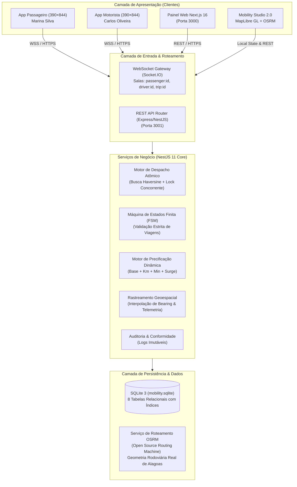
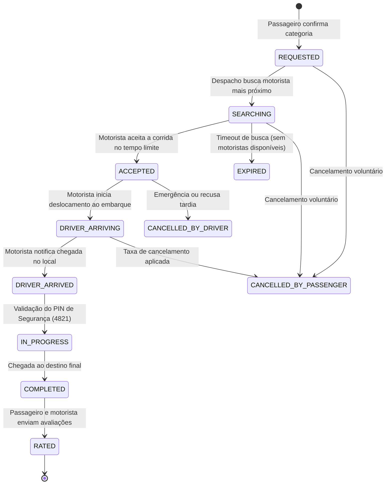

# ARQUITETURA DA PLATAFORMA MOBILITY 2.0 — SISTEMA DISTRIBUÍDO DE TRANSPORTE

> **Versão:** 2.0.0 (Release Alagoas Intermunicipal)  
> **Data:** Outubro de 2026  
> **Classificação:** Documentação Técnica de Arquitetura de Software

---

## 1. VISÃO GERAL DO SISTEMA

A **Mobility Platform 2.0** é um ecossistema completo de transporte individual e intermunicipal por aplicativo, projetado com arquitetura distribuída, tolerância a falhas, sincronização bidirecional em tempo real e alta fidelidade cartográfica com OpenStreetMap e MapLibre GL JS.

---

## 2. ESPECIFICAÇÃO DOS MÓDULOS DO BACKEND (NESTJS)

O backend foi construído em NestJS 11 modular, garantindo separação rigorosa de responsabilidades:

| Módulo | Responsabilidade Técnica | Principais Endpoints / Eventos |
| :--- | :--- | :--- |
| **AuthModule** | Autenticação JWT, hashing bcrypt e perfis RBAC | `POST /auth/login`, `POST /auth/register` |
| **UsersModule** | Cadastro, recuperação e validação de passageiros | `GET /users/:id`, `PATCH /users/:id` |
| **DriversModule** | Ciclo de vida do motorista, aprovação de CNH e status | `GET /drivers`, `PATCH /drivers/:id/status` |
| **VehiclesModule** | Registro e vistoria de veículos (categorias: economy, comfort, premium) | `GET /vehicles`, `POST /vehicles` |
| **PricingModule** | Cálculo de tarifas com bandeiradas, km rodado, tempo e multiplicador dinâmico | `GET /pricing/estimate?fromLat=...&toLat=...`, `PUT /pricing/surge` |
| **DispatchModule** | Matching geoespacial com raio configurável e fila de tolerância | WebSocket `tripRequested`, `offerDriver` |
| **TripsModule** | Gerenciamento de ciclo de vida de viagens e persistência da FSM | `POST /trips`, `PATCH /trips/:id/status` |
| **LocationModule** | Telemetria contínua, histórico de deslocamento e cálculo Haversine | `POST /location/update`, `GET /location/driver/:id` |
| **PaymentsModule** | Liquidação financeira, simulação de gateway e comprovantes | `POST /payments/process` |
| **AuditModule** | Registro imutável de todas as transições de estado para compliance | `GET /audit/logs` |
| **AdminModule** | Agregação analítica para o dashboard administrativo | `GET /admin/dashboard` |
| **WebSocketModule** | Gateway Socket.IO com multiplexação de salas privadas | Rooms: `passenger:{id}`, `driver:{id}`, `trip:{id}` |

---

## 3. MÁQUINA DE ESTADOS FINITA (FSM) DE VIAGEM

A máquina de estados impede anomalias de transição de status (por exemplo, motorista iniciar corrida antes de chegar ao passageiro):

---

## 4. MODELO DE DADOS GEOESPACIAIS (SQLITE)

O banco de dados SQLite armazena coordenadas de alta precisão (dupla precisão IEEE 754):

- **Tabela `trips`**:
  - `originLat`, `originLng`: Coordenadas de embarque (ex: Piaçabuçu `-10.4056, -36.4344`).
  - `destLat`, `destLng`: Coordenadas de desembarque (ex: Penedo `-10.2897, -36.5864`).
  - `distanceKm`: Distância real percorrida em rodovia (28,2 km).
  - `durationMin`: Duração de tráfego (~28 a 35 min).
  - `fare`: Valor cobrado em Reais (BRL).
  - `category`: Categoria contratada (`economy`, `comfort`, `premium`).
- **Tabela `driver_locations`**:
  - `driverId`: Chave estrangeira do motorista.
  - `lat`, `lng`: Posição instantânea.
  - `heading`: Ângulo de azimute/rolamento em graus (0° a 360°).
  - `speed`: Velocidade instantânea em km/h.
  - `timestamp`: Marcação temporal UTC.

---

## 5. INTEGRAÇÃO CARTOGRÁFICA COM MAPLIBRE GL JS & OSRM

A arquitetura do **Mobility Studio 2.0** adota MapLibre GL JS para renderização WebGL acelerada por hardware:
1. **Camada Base de Tiles:** OpenStreetMap Standard raster tiles (`tile.openstreetmap.org`).
2. **Camada de Vetor Rodoviário:** Polilinha GeoJSON de 485 nós, traçando com exatidão a rodovia AL-101 Sul e AL-225 até Penedo.
3. **Cálculo de Rotação do Veículo:** Fórmula esférica de azimute (*forward azimuth*) calculada entre o nó atual e o próximo nó da rodovia, assegurando que o carro vire nas curvas realisticamente.
4. **Câmeras Dinâmicas:** Modos de visualização ampla da rodovia (*fitBounds*) e perseguição suave do veículo (*followCar*).
