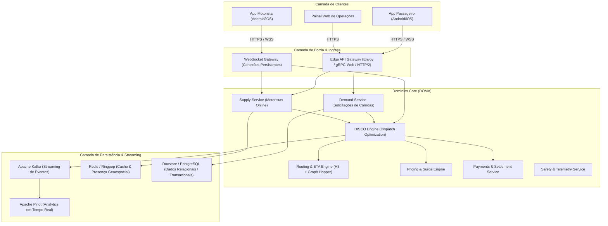

# Arquitetura Observada e Heurísticas de Engenharia

> [!NOTE]
> Análise arquitetural baseada em publicações de engenharia de larga escala (Uber Engineering Blog, conferências QCon, Uber open-source repositories e artigos acadêmicos).

---

## 1. Topologia Geral do Sistema

A arquitetura do Uber migrou historicamente de uma estrutura monolítica para a arquitetura **DOMA (Domain-Oriented Microservice Architecture)**, composta por milhares de microsserviços distribuídos em gateways especializados:

---

## 2. Componentes Arquiteturais Detalhados

### 2.1 DISCO — Dispatch Optimization Engine
- **Classificação:** 🟢 OBSERVADA (Uber Eng Blog: "How Uber Optimizes Dispatch")
- **Responsabilidade:** Casar requisições de passageiros com os motoristas mais adequados em frações de segundo.
- **Funcionamento:**
  1. Utiliza a grade espacial **H3** para particionar o globo terrestre em hexágonos hierárquicos.
  2. Consulta o estado de oferta (*Supply*) nos hexágonos adjacentes (k-ring de alcance).
  3. Estima o tempo até o embarque (ETA) considerando tráfego histórico e em tempo real.
  4. Executa otimização combinatória: em áreas densas, não atribui imediatamente o motorista mais próximo (estratégia gulosa / greedy), mas agrupa solicitações em janelas curtas (batching de 2 a 5 segundos) para maximizar a utilidade global da frota e minimizar o tempo médio de espera.

### 2.2 Sistema de Indexação Espacial H3
- **Classificação:** 🟢 OBSERVADA (Open-source sob licença Apache 2.0 pelo Uber)
- **Vantagens de Hexágonos sobre Quadrantes (Geohash / S2):**
  - Distância constante entre o centro de um hexágono e todos os seus 6 vizinhos imediatos (sem diagonais assimétricas).
  - Decomposição hierárquica suave em múltiplos níveis de resolução.
  - Otimização extrema para agregação de densidade de tráfego e cálculo de dinâmico (Surge).

### 2.3 Camada de Real-time e Conexões Persistentes
- **Classificação:** 🟢 OBSERVADA / 🟡 INFERIDA
- **Mecanismos:**
  - O aplicativo do motorista mantém um canal persistente (WebSocket sobre TLS ou gRPC bidirecional com HTTP/2) enviando telemetria periódica.
  - Heartbeat a cada poucos segundos com dados de precisão, rumo, altitude e status.
  - Tolerância a falhas: quando o canal cai em túneis ou zonas de sombra celular, os pontos de localização são armazenados em buffer local no dispositivo (SQLite local) e enviados em lote após a reconexão.

### 2.4 Máquina de Estados de Corridas (Trip State Machine)
- **Classificação:** 🟢 OBSERVADA
- **Invariantes Arquiteturais:**
  1. Uma corrida só pode ser aceita por exatamente 1 motorista. Evita-se race condition com bloqueio otimista ou travas distribuídas (Redis Redlock ou operações condicionais `UPDATE ... WHERE status = 'SEARCHING'`).
  2. Nenhuma transição para trás é permitida na linha temporal positiva (ex: `IN_PROGRESS` nunca volta para `ACCEPTED`).
  3. O passageiro e o motorista recebem mensagens idempotentes com identificador de versão sequencial (`version` ou `sequence_number`) para prevenir inconsistência por entrega fora de ordem de pacotes de rede.

### 2.5 Arquitetura Mobile — RIBs
- **Classificação:** 🟢 OBSERVADA (GitHub uber/RIBs)
- **Componentes:**
  - **Router:** Manipula transições entre estados e anexação/desanexação de nós filhos.
  - **Interactor:** Detém a lógica de negócio, reage a eventos e coordena chamadas a serviços.
  - **Builder:** Instancia dependências com injeção segura.
  - **View (Opcional):** Renderiza a tela. RIBs de sincronização de localização em background não possuem View.

---

## 3. Diretrizes para a Plataforma Independente (Mobility Platform)

Para nossa implementação independente funcional no ambiente local:
1. **Modelagem de Entidades:** Espelha o modelo relacional de Supply, Demand, Trips e Ratings.
2. **Geolocalização:** No backend SQLite, utiliza-se a fórmula trigonométrica de **Haversine** otimizada com indexação de bounding-box para busca em raio, mantendo compatibilidade direta com operadores PostGIS `ST_DWithin` e `ST_DistanceSphere`.
3. **Dispatch Engine:** Módulo dedicado `DispatchModule` com controle atômico em memória para despachar para motoristas mais próximos com timeout e rotação de fila.
4. **Comunicação WebSocket:** Socket.IO padronizado com salas isoladas (`passenger:<id>`, `driver:<id>`, `trip:<id>`).
