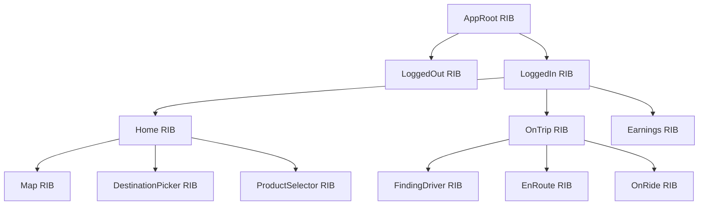
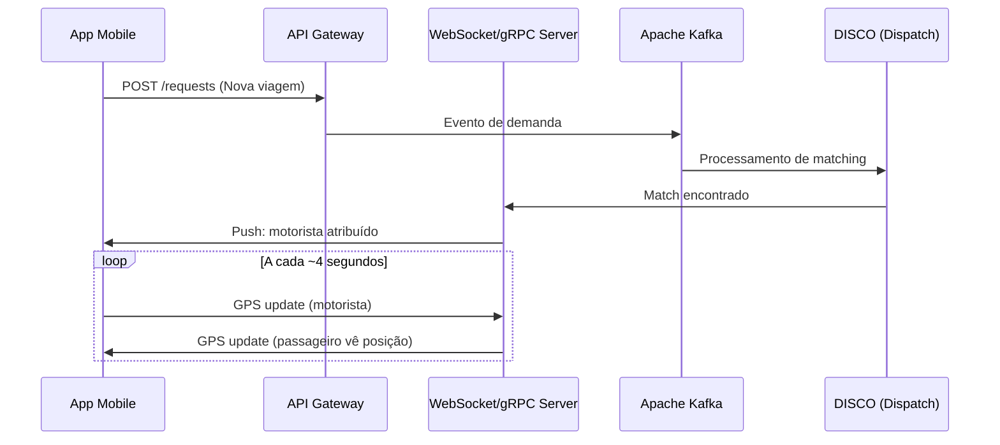

# Componentes Android — Aplicativo Uber

> [!NOTE]
> Esta análise é baseada inteiramente em fontes públicas: Google Play Store, documentação oficial do Android, blog de engenharia do Uber e projetos open-source. Nenhum APK foi descompilado.

---

## 1. Permissões do Aplicativo (Google Play Store)

### 1.1 Permissões Essenciais 🟢 OBSERVADA

| Permissão | Categoria Android | Justificativa Funcional |
|---|---|---|
| `ACCESS_FINE_LOCATION` | Localização | GPS preciso para pickup, tracking em tempo real, matching com motoristas |
| `ACCESS_COARSE_LOCATION` | Localização | Localização aproximada por torres de celular/Wi-Fi |
| `ACCESS_BACKGROUND_LOCATION` | Localização | Tracking contínuo para motoristas (app Driver) |
| `CAMERA` | Câmera | Foto de perfil, scan de cartão de crédito, documentos para suporte |
| `READ_CONTACTS` | Contatos | Split de tarifa, compartilhamento de viagem, convites |
| `POST_NOTIFICATIONS` | Notificações | Status da viagem, chegada do motorista, recibos, promoções |
| `CALL_PHONE` | Telefone | Chamadas mascaradas entre motorista e passageiro |
| `BLUETOOTH` / `BLUETOOTH_CONNECT` | Dispositivos próximos | Beacons de veículos, localização indoor em aeroportos |
| `READ_EXTERNAL_STORAGE` | Armazenamento | Upload de fotos/documentos |
| `INTERNET` | Rede | Comunicação com servidores backend |

### 1.2 Permissões Inferidas 🟡 INFERIDA

| Permissão | Justificativa |
|---|---|
| `FOREGROUND_SERVICE` | Necessário para manter tracking GPS ativo durante viagens |
| `RECEIVE_BOOT_COMPLETED` | Reiniciar serviços após reboot do dispositivo (app Driver) |
| `VIBRATE` | Alertas hápticos para notificações de viagem |
| `WAKE_LOCK` | Manter CPU ativa durante operações críticas em background |
| `ACCESS_NETWORK_STATE` | Verificar conectividade antes de requisições |
| `ACCESS_WIFI_STATE` | Otimização de localização via Wi-Fi |

### 1.3 Permissões Desconhecidas 🔴 DESCONHECIDA

| Aspecto | Por quê? |
|---|---|
| Lista completa do AndroidManifest.xml | Requer descompilação do APK |
| Permissões personalizadas (custom permissions) | Requer análise do manifest |
| Nível de proteção (normal/dangerous/signature) | Requer manifest completo |

---

## 2. Arquitetura de Componentes — Framework RIBs

### 2.1 Visão Geral do RIBs 🟢 OBSERVADA

O Uber utiliza o framework **RIBs** (Router, Interactor, Builder, View) como arquitetura principal de seus apps móveis. É open-source no GitHub (`uber/RIBs`).

### 2.2 Componentes de um RIB 🟢 OBSERVADA

| Componente | Responsabilidade | Testabilidade |
|---|---|---|
| **Interactor** | Lógica de negócios, processamento de eventos, decisões | Alta — isolado da UI |
| **Router** | Navegação, ciclo de vida de RIBs filhos (attach/detach) | Alta — sem dependência de UI |
| **Builder** | Instanciação do RIB, injeção de dependências (DI) | N/A — infraestrutura |
| **View** (opcional) | Apresentação visual, tradução de dados em UI | Média — depende de framework UI |

### 2.3 Princípios Arquiteturais 🟢 OBSERVADA

1. **Lógica de negócio dirige o app**, não a árvore de views
2. **Árvore de estados**, não de telas — ex: `LoggedOut → LoggedIn → OnTrip`
3. **Consistência cross-platform** — estrutura idêntica entre iOS e Android
4. **Fluxo de dados reativo** — RxJava/RxSwift com DI hierárquico
5. **Comunicação descendente** via streams, **comunicação ascendente** via listener interfaces
6. **RIBs sem View** — para estados puramente lógicos (ex: estado "logado")

---

## 3. Componentes Android Padrão (Inferidos)

### 3.1 Activities 🟡 INFERIDA

| Activity Provável | Função | Evidência |
|---|---|---|
| `MainActivity` / `HomeActivity` | Activity raiz que hospeda toda a árvore de RIBs | Padrão single-activity comum em apps com RIBs |
| `SplashActivity` | Tela de loading inicial, verificação de autenticação | Comportamento observável ao abrir o app |
| `DeepLinkActivity` | Handler para deep links `uber://` e `https://m.uber.com/ul/` | Documentação de deep links na API pública |
| `WebViewActivity` | Carregamento de conteúdo web (termos, ajuda) | Comportamento observável |

> [!TIP]
> O padrão **single-activity** é fortemente sugerido pela arquitetura RIBs, onde uma única Activity hospeda toda a árvore de RIBs e a navegação é gerenciada pelos Routers, não por transições de Activity.

### 3.2 Services 🟡 INFERIDA

| Service Provável | Tipo | Função |
|---|---|---|
| `LocationTrackingService` | Foreground Service | Coleta contínua de GPS durante viagens |
| `TripUpdateService` | Foreground Service | Manter conexão WebSocket/gRPC para atualizações em tempo real |
| `FirebaseMessagingService` | Service | Recebimento de push notifications via FCM |
| `DriverOnlineService` | Foreground Service | Manter o motorista "online" com GPS ativo (app Driver) |

### 3.3 BroadcastReceivers 🟡 INFERIDA

| Receiver Provável | Função |
|---|---|
| `BootReceiver` | Reiniciar serviços após reboot |
| `ConnectivityReceiver` | Detectar mudanças de rede |
| `GeofenceReceiver` | Processar transições de geofence (pickup zones, aeroportos) |

### 3.4 Content Providers 🔴 DESCONHECIDA

Não há informação pública sobre Content Providers internos do Uber. Provavelmente utilizam Room/SQLite diretamente sem expor dados via ContentProvider.

---

## 4. Bibliotecas e Frameworks (Conhecidos e Inferidos)

### 4.1 Confirmados (Open-Source/Documentados) 🟢 OBSERVADA

| Biblioteca | Função | Fonte |
|---|---|---|
| **RIBs** | Arquitetura mobile | GitHub uber/RIBs |
| **RxJava 2/3** | Programação reativa | Documentação RIBs |
| **Dagger 2** / Anvil | Injeção de dependência | Padrão RIBs (DI hierárquico) |
| **Google Maps SDK** | Renderização de mapas | Comportamento visual do app |
| **H3** | Indexação geoespacial (backend, possível uso local) | GitHub uber/H3 |

### 4.2 Altamente Prováveis 🟡 INFERIDA

| Biblioteca | Função | Evidência |
|---|---|---|
| **OkHttp + Retrofit** | Comunicação HTTP com APIs REST | Padrão de mercado para Android |
| **gRPC** | Comunicação bidimensional em tempo real | Blog de engenharia menciona gRPC |
| **Glide / Coil** | Carregamento de imagens (perfis, mapas) | Padrão Android |
| **Firebase (FCM)** | Push notifications | Comportamento de notificações |
| **Room / SQLite** | Armazenamento local | Necessário para cache offline |
| **Jetpack Navigation** ou custom | Navegação (embora RIBs Routers já façam isso) | Pode ser híbrido |
| **LeakCanary** (debug) | Detecção de memory leaks | Prática padrão |
| **Crashlytics / Bugsnag** | Crash reporting | Prática padrão em apps de grande escala |

### 4.3 Desconhecidos 🔴 DESCONHECIDA

| Aspecto | Por quê? |
|---|---|
| SDKs de analytics exatos (Amplitude, Mixpanel, etc.) | Requer análise de dependências do APK |
| SDKs de ads/atribuição (Adjust, AppsFlyer, etc.) | Requer análise de dependências |
| Versões exatas das bibliotecas | Requer build.gradle ou APK |
| Ferramentas de A/B testing | Requer código-fonte |

---

## 5. Comunicação em Tempo Real

### 5.1 Protocolos 🟡 INFERIDA

### 5.2 Detalhes de Implementação 🟡 INFERIDA

- **WebSocket ou gRPC bidirecional** para streaming de localização em tempo real
- **Frequência de GPS**: ~4 segundos (mencionado em fontes públicas)
- **Interpolação client-side**: suavização de movimento do carro no mapa
- **Map-matching / Filtro de Kalman**: correção de GPS no backend antes de enviar ao rider
- **Kafka como backbone**: todos os eventos (GPS, viagem, pagamento) passam por Kafka

---

## 6. Armazenamento Local

### 6.1 Dados em Cache 🟡 INFERIDA

| Tipo de Dado | Mecanismo Provável | Razão |
|---|---|---|
| Token de autenticação | EncryptedSharedPreferences / Keystore | Segurança |
| Endereços recentes | Room/SQLite | Acesso offline rápido |
| Configurações do usuário | SharedPreferences | Persistência leve |
| Tiles de mapa | Cache do Google Maps SDK | Performance |
| Dados de viagem ativa | Room/SQLite + memória | Recuperação de falhas |

---

## 7. Segurança do Aplicativo

### 7.1 Medidas Observáveis 🟢 OBSERVADA

- **Verificação de PIN do passageiro** antes do embarque
- **Chamadas mascaradas** (número do motorista/passageiro não exposto)
- **RideCheck** — detecção de anomalias via sensores (parada prolongada, impacto)
- **Botão de emergência** — acesso rápido a serviços de emergência com dados da viagem
- **Compartilhamento de viagem** — link ao vivo para contatos de confiança

### 7.2 Medidas Inferidas 🟡 INFERIDA

- **Certificate pinning** para prevenir MITM
- **Ofuscação com ProGuard/R8**
- **Criptografia de dados sensíveis** em repouso (Android Keystore)
- **Detecção de root/tamper** (SafetyNet/Play Integrity API)

### 7.3 Medidas Desconhecidas 🔴 DESCONHECIDA

- Detalhes exatos de certificate pinning
- Nível de ofuscação do código
- Implementação de anti-tampering
- Criptografia de banco de dados local

---

*Documento gerado em outubro de 2026. Baseado exclusivamente em informações publicamente disponíveis.*
