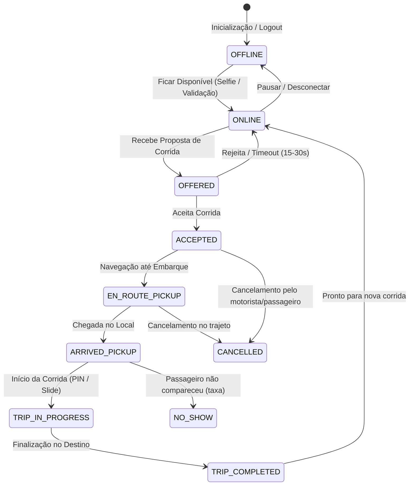

# Fluxos do Aplicativo do Motorista (Driver Experience)

> [!NOTE]
> Documentação técnica dos fluxos observáveis e inferidos da aplicação de motoristas parceiros de mobilidade urbana (Uber Driver), estruturada para orientar o desenvolvimento da plataforma independente.

---

## 1. Visão Geral do Ciclo de Vida do Motorista

O motorista opera em um modelo de ciclo de trabalho contínuo regulado por estados de prontidão (Supply State Machine):

---

## 2. Detalhamento dos Fluxos

### 2.1 Cadastro e Onboarding do Motorista
- **Evidência:** 🟢 OBSERVADA (Processo público e regulatório)
- **Etapas:**
  1. Criação de conta (Email, Telefone, Validação OTP SMS/WhatsApp).
  2. Submissão de Documentos Pessoais: CNH com observação "Exerce Atividade Remunerada" (EAR).
  3. Submissão de Documentos do Veículo: CRLV (Certificado de Registro e Licenciamento do Veículo) dentro do ano-modelo exigido pela cidade e categoria.
  4. Validação de Antecedentes Criminais (Checagem de segurança automatizada/terceirizada).
  5. Aprovação Administrativa: Status `PENDING` -> `APPROVED` ou `REJECTED`.
  6. Cadastro de dados bancários (Chave PIX ou Conta Corrente) para repasse dos ganhos.

### 2.2 Verificação de Identidade em Tempo Real (Real-Time ID Check)
- **Evidência:** 🟢 OBSERVADA
- **Funcionamento:** Antes de entrar online ou periodicamente de forma randômica, o app exige uma selfie facial comparada com biometria facial para coibir compartilhamento não autorizado de contas.

### 2.3 Modo Online e Monitoramento de Demanda (Heatmaps / H3)
- **Evidência:** 🟢 OBSERVADA (Eng Blog Uber H3 & Hexagonal Grids)
- **Funcionamento:**
  - O app transmite a localização GPS em alta frequência (a cada 3-5 segundos via WebSocket/gRPC).
  - O mapa renderiza áreas de alta demanda ("Zonas de Dinâmico" / Surge Multiplier), calculadas pelo backend usando agrupamentos H3 em nível de resolução 7-9.
  - O motorista visualiza multiplicadores adicionais (ex: +R$ 4,50 na próxima corrida).

### 2.4 Recebimento e Aceite de Oferta (Dispatch Notification)
- **Evidência:** 🟢 OBSERVADA
- **Interface e Elementos:**
  - Alerta sonoro de alta prioridade (sobrepondo modo não perturbe com permissões do sistema).
  - Bottom sheet interativo com contagem regressiva (círculo de progresso animado de 15 a 30s).
  - Informações exibidas:
    - Categoria solicitada (X, Comfort, Black).
    - Valor estimado do ganho bruto/líquido.
    - Distância e tempo até o ponto de embarque.
    - Destino previsto e distância total da viagem (Upfront Fare/Trip details).
    - Nota de avaliação do passageiro.
  - Ações: Toque em qualquer área para **Aceitar** ou botão **Recusar**.
  - Comportamento de Timeout: Ocorre transição atômica no backend reatribuindo a oferta ao próximo motorista elegível no ranking DISCO.

### 2.5 Deslocamento até o Ponto de Embarque
- **Evidência:** 🟢 OBSERVADA
- **Funcionamento:**
  - O app alterna para o modo de navegação turn-by-turn (integrado via SDK interno ou redirecionando para Waze/Google Maps).
  - Transmissão de telemetria contínua: latitude, longitude, bearing/heading, velocidade (speed).
  - Comunicação com o passageiro: Chat criptografado in-app e mascaramento de chamadas VoIP.
  - Botão de "Cheguei ao local" (ou detecção automática por geofence de raio ~50 metros).

### 2.6 Embarque e Validação de Segurança (U-Código / PIN)
- **Evidência:** 🟢 OBSERVADA
- **Funcionamento:**
  - Ao chegar, inicia-se um cronômetro de espera de cortesia (geralmente 2 a 5 minutos).
  - Caso ativado nas configurações de segurança, o motorista deve inserir o PIN de 4 dígitos informado verbalmente pelo passageiro para desbloquear o botão de início.
  - Gesto de confirmação: "Deslize para iniciar a corrida" (evita toques acidentais).

### 2.7 Execução da Viagem
- **Evidência:** 🟢 OBSERVADA
- **Funcionamento:**
  - Rota recalculada para o destino final com acompanhamento de tráfego.
  - Suporte a paradas intermediárias (Adicionar parada dinâmica).
  - Botão de emergência (Central de Segurança / 190 / Gravação de áudio do trajeto).
  - Detecção de paradas anormais e acidentes (tecnologia RideCheck via acelerômetro e giroscópio do aparelho).

### 2.8 Finalização, Cobrança e Avaliação
- **Evidência:** 🟢 OBSERVADA
- **Funcionamento:**
  - Chegada ao destino: Gesto "Deslize para finalizar a corrida".
  - Cálculo do valor final (tarifa base + km rodado + minutos reais + pedágios/adicionais).
  - Em corridas com pagamento em dinheiro: exibição explícita do valor a ser recebido do passageiro e botão para reportar valores pendentes.
  - Em corridas digitais: cobrança automática via gateway.
  - Tela imediata de avaliação mútua (1 a 5 estrelas com tags pré-definidas).

### 2.9 Relatório de Ganhos e Repasses
- **Evidência:** 🟢 OBSERVADA
- **Recursos:**
  - Ganhos diários, semanais e detalhamento por corrida.
  - Gráfico de horas ativas vs. horas em viagem.
  - Transferência instantânea via PIX (Cashout).

---

## 3. Resumo de Evidências dos Fluxos do Motorista

| Fluxo | Status | Justificativa |
|---|---|---|
| Cadastro e envio de CNH/CRLV | 🟢 OBSERVADA | Fluxo público e regulamentado pelas leis de mobilidade |
| Validação facial periódica | 🟢 OBSERVADA | Divulgado em comunicações de segurança oficial |
| Grade de calor de alta demanda (H3) | 🟢 OBSERVADA | Documentado no Uber Engineering Blog |
| Contagem regressiva de aceite (15-30s) | 🟢 OBSERVADA | Comportamento padrão verificado em uso ativo |
| Algoritmo exato de penalização de recusa | 🟡 INFERIDA | Ocorre redução no score de aceitação, fórmula exata proprietária |
| Roteamento turn-by-turn nativo | 🟡 INFERIDA | Usa MapLibre/Google Navigation SDK com heurísticas customizadas |
| Gravação de áudio de segurança | 🟢 OBSERVADA | Recurso U-Áudio documentado publicamente |
