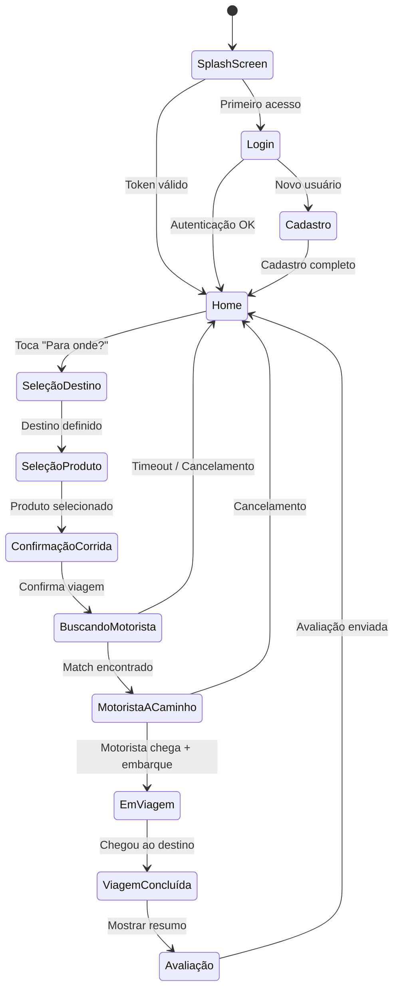
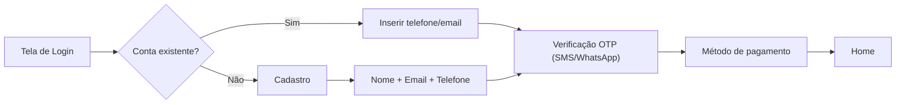
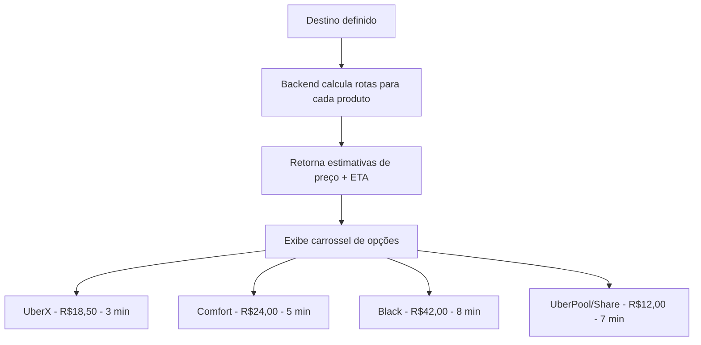
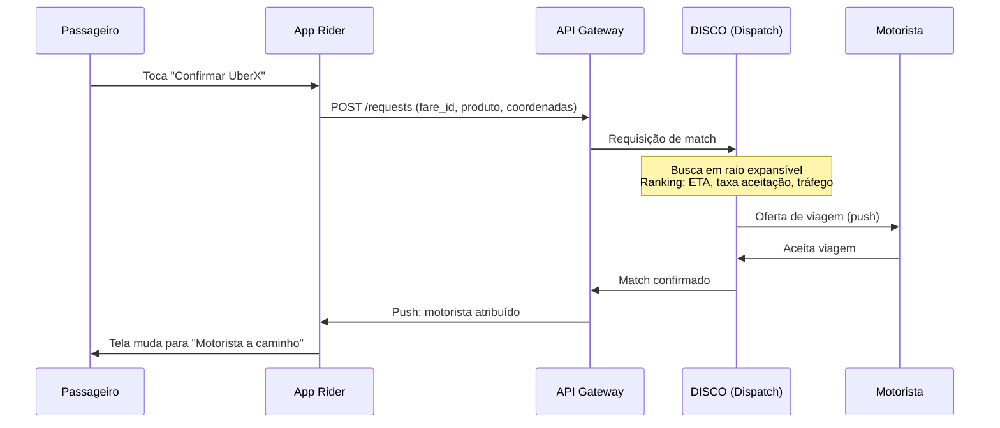
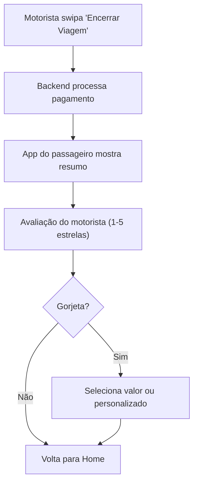
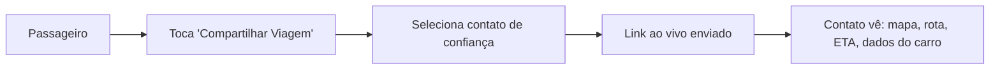

# Fluxos do Passageiro — Aplicativo Uber Rider

> [!NOTE]
> Documentação baseada em fontes públicas: documentação oficial do Uber, APIs públicas, comportamento observável do app e blog de engenharia. Classificação: 🟢 OBSERVADA | 🟡 INFERIDA | 🔴 DESCONHECIDA.

---

## 1. Visão Geral dos Fluxos



---

## 2. Fluxo 1 — Abertura do App e Autenticação

### 2.1 Splash Screen e Verificação de Sessão 🟢 OBSERVADA

1. **App inicia** → Tela de splash com logo Uber
2. **Verificação de token** → Valida token de autenticação armazenado
3. **Decisão**:
   - Token válido → Navega para **Home**
   - Token expirado/ausente → Navega para **Login**

### 2.2 Login / Cadastro 🟢 OBSERVADA



**Detalhes do Login:**
- Autenticação principal via **número de telefone + OTP** (código por SMS ou WhatsApp)
- Suporte a login social (Google, Apple, Facebook) — 🟢 OBSERVADA
- OAuth 2.0 com escopos específicos para APIs — 🟢 OBSERVADA (documentação developer.uber.com)
- Token de sessão armazenado localmente — 🟡 INFERIDA

---

## 3. Fluxo 2 — Tela Home (Pré-Requisição)

### 3.1 Elementos da Tela Principal 🟢 OBSERVADA

| Elemento | Função | Classificação |
|---|---|---|
| **Mapa** (Google Maps) | Exibe localização atual e carros próximos | 🟢 |
| **Barra "Para onde?"** | Input de destino, inicia fluxo de requisição | 🟢 |
| **Carros animados no mapa** | Representação visual de motoristas próximos disponíveis | 🟢 |
| **Menu lateral / Perfil** | Acesso a histórico, pagamento, promoções, configurações | 🟢 |
| **Endereços salvos** (Casa, Trabalho) | Atalhos de destino frequente | 🟢 |
| **Promoções ativas** | Banners com descontos e ofertas | 🟢 |

### 3.2 Fluxo de Dados em Background 🟡 INFERIDA

1. **GPS do dispositivo** → Obtém coordenadas atuais
2. **Reverse geocoding** → Converte coordenadas em endereço legível
3. **Consulta de motoristas próximos** → Backend retorna posições via WebSocket/gRPC
4. **Renderização no mapa** → Ícones de carros com interpolação de movimento suave
5. **Indexação H3/S2** → Backend agrupa motoristas em células hexagonais para busca eficiente

---

## 4. Fluxo 3 — Seleção de Destino

### 4.1 Etapas 🟢 OBSERVADA

1. **Toca em "Para onde?"** → Abre tela de busca
2. **Autocomplete de endereço** → Sugestões em tempo real (Google Places API)
3. **Endereços recentes** → Lista dos últimos destinos usados
4. **Endereços salvos** → Casa, Trabalho, Favoritos
5. **Seleção no mapa** → Arrastar pin para posição desejada
6. **Confirmação de pins** → Pin de embarque (pickup) + Pin de desembarque (dropoff)

### 4.2 Dados Enviados ao Backend 🟢 OBSERVADA (API Pública v1.2)

```json
{
  "start_latitude": -23.5505,
  "start_longitude": -46.6333,
  "end_latitude": -23.5629,
  "end_longitude": -46.6544,
  "product_id": "a1111c8c-c720-46c3-8534-2fcdd730040d"
}
```

- Endpoint: `POST /v1.2/requests/estimate` — retorna estimativa de preço e `fare_id`

---

## 5. Fluxo 4 — Seleção de Produto e Preço Upfront

### 5.1 Carrossel de Produtos 🟢 OBSERVADA



**Informações exibidas por produto:**

| Informação | Exemplo | Classificação |
|---|---|---|
| Nome do produto | UberX, Comfort, Black, Flash | 🟢 |
| Preço estimado (upfront) | R$ 18,50 | 🟢 |
| ETA do motorista mais próximo | 3 minutos | 🟢 |
| Tempo estimado da viagem | 22 minutos | 🟢 |
| Fator surge (preço dinâmico) | 1.5x (quando aplicável) | 🟢 |
| Capacidade do veículo | 4 passageiros | 🟢 |

### 5.2 Precificação Dinâmica (Surge) 🟢 OBSERVADA

- Quando a demanda supera a oferta, o preço é multiplicado
- O app exibe o fator de multiplicação ou o preço final já ajustado
- O passageiro deve confirmar explicitamente o preço com surge
- Implementação interna do cálculo de surge é 🔴 DESCONHECIDA

---

## 6. Fluxo 5 — Confirmação e Busca de Motorista

### 6.1 Processo de Requisição 🟢 OBSERVADA



### 6.2 Tela "Buscando Motorista" 🟢 OBSERVADA

- Animação de busca (ondas/radar expandindo)
- Barra de progresso circular
- Possibilidade de cancelar sem custo (dentro do período de graça)
- Se nenhum motorista aceitar: mensagem de indisponibilidade

### 6.3 Processo Interno de Matching 🟡 INFERIDA

- **DISCO** avalia motoristas em um raio geoespacial expansível
- Utiliza **Google S2 Library** ou **H3** para indexação espacial
- **Batch matching** — agrupa múltiplas requisições em janelas de segundos
- **Algoritmo húngaro / matching bipartido** para otimização global
- **Future dispatch** — pode atribuir motoristas que estão terminando outra viagem

---

## 7. Fluxo 6 — Motorista a Caminho (En Route to Pickup)

### 7.1 Interface do Passageiro 🟢 OBSERVADA

| Elemento | Descrição |
|---|---|
| **Dados do motorista** | Nome, foto, avaliação (estrelas), número de viagens |
| **Dados do veículo** | Modelo, cor, placa |
| **ETA dinâmico** | "Chegando em 3 minutos" — atualiza em tempo real |
| **Rota no mapa** | Polyline do motorista até o ponto de embarque |
| **Carro no mapa** | Ícone que se move suavemente pela rota |
| **Botões de ação** | Ligar, enviar mensagem, compartilhar viagem, cancelar |

### 7.2 Tracking em Tempo Real 🟡 INFERIDA

1. **Motorista transmite GPS** a cada ~4 segundos via conexão persistente
2. **Backend recebe, processa** (map-matching, filtro de Kalman)
3. **Backend envia posição** ao passageiro via WebSocket/gRPC
4. **Client-side interpolation** suaviza movimento entre atualizações
5. **ETA recalculado** dinamicamente com base em tráfego ao vivo

### 7.3 Funcionalidades de Contato 🟢 OBSERVADA

- **Chamada mascarada** — motorista e passageiro se comunicam sem expor números reais
- **Chat in-app** — mensagens de texto dentro do aplicativo
- **Compartilhar viagem** — link ao vivo para contatos de confiança

---

## 8. Fluxo 7 — Viagem em Andamento

### 8.1 Transição para Viagem Ativa 🟢 OBSERVADA

1. Motorista chega ao ponto de embarque
2. App do motorista: swipe para **"Iniciar Viagem"**
3. App do passageiro: mapa atualiza para mostrar rota até o destino
4. ETA do destino exibido e atualizado dinamicamente

### 8.2 Durante a Viagem 🟢 OBSERVADA

| Funcionalidade | Descrição | Classificação |
|---|---|---|
| **Tracking ao vivo** | Posição do carro no mapa atualizada em tempo real | 🟢 |
| **ETA dinâmico** | Recalculado conforme tráfego muda | 🟢 |
| **Alterar destino** | Passageiro pode mudar destino; preço recalculado | 🟢 |
| **Adicionar parada** | Paradas intermediárias (limite de 2-3) | 🟢 |
| **Safety Shield** | Ícone de escudo azul para acesso a ferramentas de segurança | 🟢 |
| **RideCheck** | Detecção automática de anomalias (impacto, parada longa) | 🟢 |
| **Botão de emergência** | Chamar 911/polícia com dados da viagem | 🟢 |
| **Split fare** | Dividir o custo com outros passageiros Uber | 🟢 |

---

## 9. Fluxo 8 — Conclusão e Pós-Viagem

### 9.1 Finalização 🟢 OBSERVADA



### 9.2 Tela de Resumo Pós-Viagem 🟢 OBSERVADA

| Informação | Exemplo |
|---|---|
| Rota percorrida | Visualização no mapa |
| Valor cobrado | R$ 18,50 |
| Método de pagamento | Visa •••• 4242 |
| Distância percorrida | 8,3 km |
| Tempo de viagem | 22 minutos |
| Avaliação do motorista | ★★★★★ |
| Opção de gorjeta | R$ 2 / R$ 5 / R$ 10 / Personalizado |

### 9.3 Processamento de Pagamento 🟡 INFERIDA

- **Tokenização de cartão** — dados do cartão nunca armazenados no dispositivo
- **Processamento server-side** — cobrança acontece no backend
- **Recibo por e-mail** — enviado automaticamente após a viagem
- **Métodos aceitos**: Cartão de crédito/débito, PIX, dinheiro, vale-refeição, créditos Uber

---

## 10. Fluxos Secundários

### 10.1 Agendamento de Viagem 🟢 OBSERVADA

- Selecionar data e hora futura para a viagem
- Reserva antecipada com preço estimado
- Notificação push quando o motorista for designado

### 10.2 Uber Reserve 🟢 OBSERVADA

- Reserva antecipada com motorista dedicado
- Preço definido no momento da reserva
- Motorista chega com antecedência no horário agendado

### 10.3 Histórico de Viagens 🟢 OBSERVADA

- Lista de todas as viagens passadas
- Detalhes de rota, preço, motorista, data/hora
- Possibilidade de solicitar reembolso ou reportar problemas
- Download de recibos

### 10.4 Compartilhamento de Viagem 🟢 OBSERVADA



---

## 11. Fluxos de Erro e Casos Extremos

### 11.1 Cenários de Falha 🟡 INFERIDA

| Cenário | Comportamento Esperado |
|---|---|
| **Sem conexão internet** | Mensagem de erro; não permite requisitar viagem |
| **GPS desligado** | Solicita ativação; permite digitar endereço manualmente |
| **Nenhum motorista disponível** | Mensagem de indisponibilidade; opção de notificação quando disponível |
| **Pagamento recusado** | Bloqueia nova requisição; solicita atualizar método de pagamento |
| **Motorista cancela** | Notificação; busca automática de novo motorista |
| **Passageiro não encontrado** | Motorista espera ~5 min; cobra taxa de cancelamento |
| **App crash durante viagem** | 🟡 Viagem continua no backend; reabre no estado correto |
| **Perda de conexão durante viagem** | 🟡 Buffer de GPS local; reenvia ao reconectar |

---

*Documento gerado em outubro de 2026. Baseado exclusivamente em informações publicamente disponíveis.*
