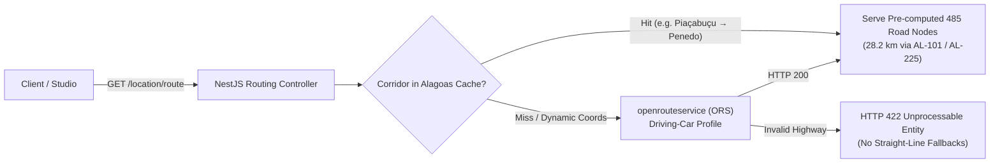

# Highway Routing & Alagoas Corridor Setup

**Document:** `docs/ROUTING_SETUP.md`  
**Platform:** SIMBORA Mobility Platform  

---

## 1. Routing Architecture

Regional ride-hailing requires accurate road network topologies rather than straight-line Euclidean distance approximations. SIMBORA routes intercity trips across the highway system of Alagoas, Brazil using a hybrid architecture:



---

## 2. Upstream OpenRouteService Configuration

For dynamic coordinate queries outside cached regional corridors, configure the backend OpenRouteService key in `services/api/.env.local`:

```env
OPENROUTESERVICE_API_KEY=replace_with_openrouteservice_api_key
```

### Key Security Safeguards
* Stored exclusively on the backend server.
* Never bundled into frontend React or HTML client code.
* Reverse-proxied via `GET /location/route` to enforce rate limiting and input sanitization.

---

## 3. Verified Alagoas Highway Corridors

The platform includes pre-compiled, high-density road geometry datasets covering the principal transit arteries in southern Alagoas:

| Corridor ID | Origin & Destination | Highways | Distance | Duration | Nodes |
| :--- | :--- | :--- | :---: | :---: | :---: |
| `piacabucu_penedo` | Piaçabuçu ↔ Penedo | AL-101 / AL-225 | **28.2 km** | 28 min | **485** |
| `penedo_igreja_nova` | Penedo ↔ Igreja Nova | AL-110 | **31.9 km** | 31 min | **381** |
| `penedo_colegio` | Penedo ↔ Porto Real do Colégio | AL-225 / BR-101 | **58.3 km** | 53 min | **744** |
| `penedo_coruripe` | Penedo ↔ Coruripe | AL-101 Sul | **58.5 km** | 56 min | **612** |
| `penedo_arapiraca` | Penedo ↔ Arapiraca | AL-110 | **72.3 km** | 68 min | **890** |
| `penedo_maceio` | Penedo ↔ Maceió | AL-101 Sul | **146.6 km** | 134 min | **1,420** |
| `piacabucu_coruripe` | Piaçabuçu ↔ Coruripe | AL-101 Sul | **48.9 km** | 44 min | **498** |

---

## 4. Turf.js Geodesic Calculations

Clients utilize [Turf.js 6.5](https://turfjs.org/) to evaluate road dynamics along the highway LineString:

1. **Total Road Length**:
   ```javascript
   const totalRouteLengthKm = turf.length(turfLineString, { units: 'kilometers' });
   ```
2. **Along-Path Interpolation**:
   ```javascript
   const currentPoint = turf.along(turfLineString, currentTraveledKm, { units: 'kilometers' });
   const nextPoint = turf.along(turfLineString, Math.min(currentTraveledKm + 0.05, totalRouteLengthKm), { units: 'kilometers' });
   ```
3. **Vehicle Heading / Bearing (0°–360°)**:
   ```javascript
   let rawBearing = turf.bearing(currentPoint, nextPoint);
   let normalizedHeading = (rawBearing + 360) % 360;
   ```
