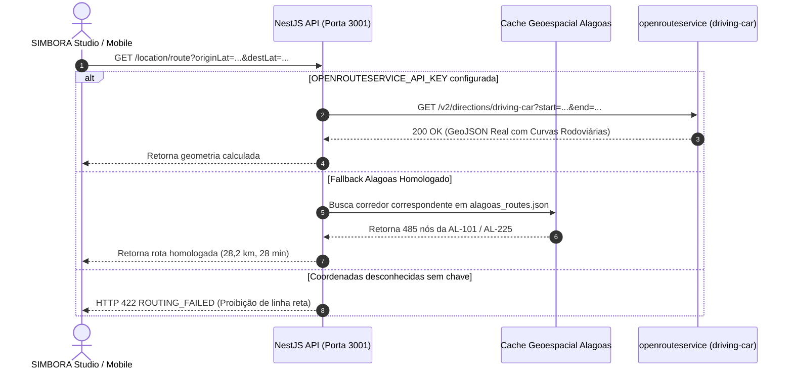

# GUIA DO SERVIÇO DE ROTEAMENTO (OPENROUTESERVICE) — SIMBORA

> **Documento:** `docs/ROUTING_SETUP.md`  
> **Finalidade:** Arquitetura do backend proxy e integração com openrouteservice

---

## 1. ARQUITETURA DE PROTEÇÃO DE CREDENCIAIS (BACKEND PROXY)

> [!IMPORTANT]
> **A chave privada do openrouteservice NUNCA é enviada ao navegador do cliente.**  
> Todas as requisições de roteamento são intermediadas pelo backend NestJS (`http://localhost:3001/location/route`), garantindo conformidade com padrões de segurança OWASP e prevenindo exaustão de cota por agentes não autorizados.



---

## 2. COMO OBTER UMA CHAVE GRATUITA NO OPENROUTESERVICE

1. Acesse o portal de desenvolvedores:  
   👉 **[https://openrouteservice.org/dev/#/signup](https://openrouteservice.org/dev/#/signup)**
2. Crie uma conta gratuita com seu e-mail.
3. Acesse a aba **"Dashboard"** e gere um **Token Padrão (Free Plan)**.
4. O plano gratuito oferece **2.000 requisições de rota por dia** (mais de 40 requisições por minuto).

---

## 3. CONFIGURAÇÃO NO BACKEND NESTJS

Adicione sua chave ao arquivo `services/api/.env` (ou no root `.env`):

```env
OPENROUTESERVICE_API_KEY=replace_with_openrouteservice_api_key
```

Ao reiniciar a API (`node dist/main.js`), o backend identificará a variável e direcionará as novas requisições diretamente aos servidores do openrouteservice com perfil `driving-car`.

---

## 4. CONTRATO DA API DE ROTA (`/location/route`)

### Requisição
```http
GET /location/route?originLat=-10.4056&originLng=-36.4344&destLat=-10.2897&destLng=-36.5864 HTTP/1.1
Host: localhost:3001
```

### Resposta de Sucesso (HTTP 200 OK)
```json
{
  "provider": "simbora_alagoas_verified",
  "profile": "driving-car",
  "routeKey": "piacabucu_penedo",
  "name": "Piaçabuçu → Penedo (Prioritário)",
  "highways": ["AL-101", "AL-225"],
  "distanceKm": 28.2,
  "durationMin": 28,
  "coordinates": [
    [-36.434405, -10.405602],
    [-36.434345, -10.405781],
    ...
    [-36.586452, -10.289673]
  ],
  "pointsCount": 485,
  "status": "OK"
}
```

### Resposta de Erro (HTTP 422 Unprocessable Entity)
Quando a rota não puder ser calculada através de rodovias reais:
```json
{
  "statusCode": 422,
  "error": "ROUTING_FAILED",
  "message": "Não foi possível calcular a rota rodoviária entre os pontos informados. A plataforma SIMBORA não utiliza linhas retas."
}
```
