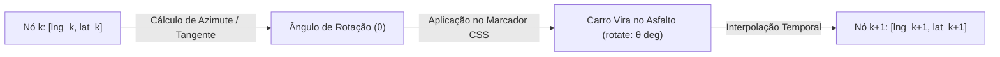

# MOTOR DE SIMULAÇÃO GEOGRÁFICA INTERMUNICIPAL — MOBILITY PLATFORM 2.0

> **Componente:** Geographic Simulation Engine (GSE)  
> **Propósito:** Simulação física de deslocamento veicular sobre rodovias reais de Alagoas  
> **Status:** IMPLEMENTADO E VALIDADO

---

## 1. VISÃO GERAL DO MOTOR DE SIMULAÇÃO

O **Geographic Simulation Engine (GSE)** é responsável por movimentar os veículos sobre a malha viária real sem saltos ou descontinuidades visuais, sincronizando em tempo real as telas do passageiro, do motorista, o HUD de telemetria e o console de eventos.

---

## 2. INTERPOLAÇÃO RODOVIÁRIA E FÍSICA DE MOVIMENTO

Em vez de uma aproximação linear simplista, o GSE utiliza os nós geográficos da rota devolvida pelo OSRM como marcos físicos da rodovia:

### 2.1 Cálculo do Ângulo de Rotação (Bearing / Azimute)

Para que o veículo curve suavemente acompanhando as curvas da AL-101 e da AL-225, o sistema calcula o azimute geodésico entre o ponto atual \( (\phi_1, \lambda_1) \) e o ponto subsequente \( (\phi_2, \lambda_2) \):

$$\Delta \lambda = \lambda_2 - \lambda_1$$

$$y = \sin(\Delta \lambda) \cdot \cos(\phi_2)$$

$$x = \cos(\phi_1) \cdot \sin(\phi_2) - \sin(\phi_1) \cdot \cos(\phi_2) \cdot \cos(\Delta \lambda)$$

$$\theta = \left( \operatorname{atan2}(y, x) \cdot \frac{180}{\pi} + 360 \right) \pmod{360}$$

O ângulo \(\theta\) resultante é aplicado diretamente à propriedade CSS `transform: rotate(θ deg)` do marcador do veículo em ambos os mapas, alinhando a dianteira do carro com a direção do tráfego.

---

## 3. MULTIPLICADORES DE VELOCIDADE E ACELERAÇÃO TEMPORAL

Como uma viagem de 28,2 km entre Piaçabuçu e Penedo demanda aproximadamente 28 a 35 minutos em tempo real, o motor implementa múltiplos fatores de aceleração temporal para agilizar testes e demonstrações:

| Multiplicador | Frequência de Tick | Tempo Total da Simulação (28,2 km) | Caso de Uso Recomendado |
| :---: | :---: | :---: | :--- |
| **1×** | 100 ms / tick | ~48,5 segundos | Avaliação detalhada de curvas e navegação HUD |
| **2×** | 50 ms / tick | ~24,2 segundos | Demonstração padrão em apresentações |
| **5×** | 20 ms / tick | ~9,7 segundos | Testes de transição de status intermediários |
| **10×** | 10 ms / tick | ~4,8 segundos | Teste rápido de ponta a ponta |
| **20×** | 5 ms / tick | ~2,4 segundos | Teste de estresse e validação de chegada ao destino |

---

## 4. MODULAÇÃO DINÂMICA DE VELOCIDADE E TRÁFEGO

O motor não utiliza uma velocidade fixa estéril. A velocidade instantânea exibida no HUD e no aplicativo do motorista oscila realisticamente entre **50 km/h e 90 km/h** em função da sinuosidade da rodovia e aceleração/frenagem simulada:

$$v(t) = 65 + 15 \cdot \sin(t) \quad [\text{km/h}]$$

- Na aproximação das áreas urbanas de Piaçabuçu e do Centro Histórico de Penedo, a velocidade reduz para acomodar curvas fechadas e cruzamentos.
- Nos trechos abertos da AL-225, o veículo atinge até 85-90 km/h.

---

## 5. SINCRONIZAÇÃO ENTRE PASSAGEIRO E MOTORISTA

Ambos os celulares (390×844) consomem o mesmo estado compartilhado (*single source of truth*):

1. **Distância Restante:** Decrementada proporcionalmente ao avanço do índice de waypoints.
2. **ETA (Estimated Time of Arrival):** Recalculado dinamicamente com base na distância remanescente.
3. **Câmera Seguir Veículo (*Follow Car*):** Se ativada pelo usuário, a câmera do mapa centraliza suavemente na nova coordenada a cada 8 ticks via interpolação `map.panTo()`.
4. **Acionamento de Chegada (*Arrival Trigger*):** Quando o índice atinge `pointsCount - 1`, o motor dispara automaticamente o evento `COMPLETED`, transicionando a tela do passageiro para a tela de avaliação de 5 estrelas e a tela do motorista para o resumo financeiro de ganhos.
